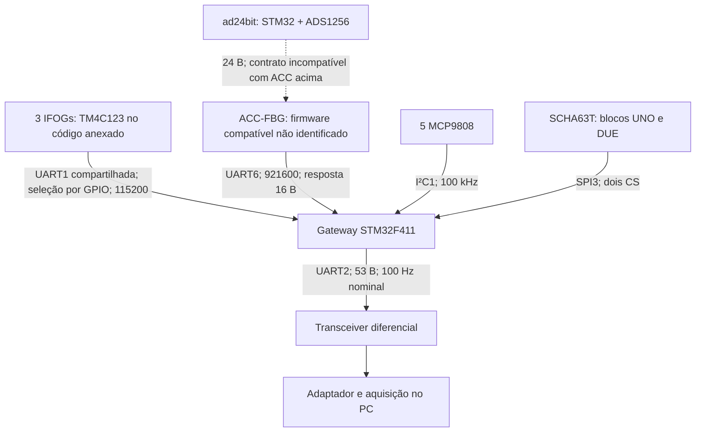

# FO-IMU IEAv — auditoria de interface e plano do testbench

Data: 28/10/2026. Base: os seis repositórios únicos e os dois PDFs anexados. Auditoria estática; nenhum equipamento foi conectado, nenhum firmware original foi modificado ou executado no alvo.

## Primeiro, em linguagem simples

O gateway funciona como o programa do seu forno que junta leituras e transmite um registro. A diferença é que aqui existem vários sistemas independentes: cada IFOG já calcula sua própria saída; o gateway pede esses números, lê ACC, temperatura e MEMS, e monta um pacote. É parecido com ler ADS1115 e um sensor I²C em sequência: colocar as duas leituras na mesma linha do CSV não faz com que tenham sido medidas ao mesmo tempo.

Podemos começar no PC e reproduzir exatamente os **bytes da saída do gateway anexado**. Isso basta para desenvolver aquisição, parser, gravação e diagnóstico sem a FO-IMU. Ainda não basta para afirmar que reproduzimos o firmware instalado no IEAv, porque os anexos descrevem revisões diferentes. O primeiro simulador será uma implementação do contrato digital identificado, com sinais sintéticos e falhas controladas.

O maior risco de integração encontrado não é a vazão normal: é a combinação de **contratos divergentes, esperas sem limite global e dados antigos ou parcialmente atualizados que continuam saindo com checksum válido**.

## 1. Escopo, evidência e limites

Classificações usadas:

- **CONFIRMADO PELO CÓDIGO:** instrução, estrutura ou caminho identificável no snapshot; não significa ocorrência medida no instrumento.
- **APARENTE INCONSISTÊNCIA:** fontes não concordam ou podem corresponder a revisões distintas.
- **HIPÓTESE:** consequência plausível, dependente de timing, montagem ou configuração não disponível.
- **PRECISA CONFIRMAR COM IEAv:** identificação da versão instalada ou comportamento que exige evidência adicional.
- **POSSÍVEL MELHORIA:** proposta posterior ao baseline, nunca apresentada como comportamento original.

Abreviações de evidência, relativas à raiz dos ZIPs extraídos:

| ID | Arquivo/fonte |
|---|---|
| G | `imu-gateway-firmware-main/imu-gateway-firmware-stm/Core/Src/main.c` |
| GM | mesmo projeto, `Core/Src/stm32f4xx_hal_msp.c` |
| GI | mesmo projeto, `imu-gateway-firmware-stm.ioc` |
| GH | mesmo projeto, `Core/Inc/stm32f4xx_hal_conf.h` |
| GU | mesmo projeto, `Drivers/STM32F4xx_HAL_Driver/Src/stm32f4xx_hal_uart.c` |
| M | mesmo projeto, `Core/Src/SCHA63T.c` |
| F | `ifog-firmware-main/main.c` |
| FU | `ifog-firmware-main/UARTCommunication.c` |
| FH | `ifog-firmware-main/UARTCommunication.h` |
| FD | `ifog-firmware-main/definitions.h` |
| A | `firmware-ifog-acc-ad24bit-main/Core/Src/main.c` |
| AD | mesmo projeto, `Core/Src/ads1256.c` |
| AT | mesmo projeto, `Core/Src/mcp9808.c` |
| AI | mesmo projeto, `smo-ifog-firmware.ioc` |
| MAN | manual v0.1.2, 11/04/2025; páginas impressas, capa sem número |
| ART | artigo anexado, DOI 10.1109/LES.2026.3682963, pp. 1–4 |
| PCB-G | `imu-gateway-pcb-main/Outputs/imu_gateway.PDF`, páginas do PDF |
| PCB-A | `pcb-ifog-acc-ad24bit-master/output/ifog_3x3.pdf`, páginas do PDF |

`source_manifest.json` registra SHA-256 de **cada arquivo** dos seis repositórios e de cada anexo. `EVIDENCIAS.md` contém trechos numerados das fontes principais. Linhas citadas neste relatório pertencem aos arquivos originais, sem normalização de texto.

Foram examinados os códigos de aplicação, configurações, drivers relevantes, READMEs, projeto LabVIEW, esquemas exportados, documentação e inventário dos binários/artefatos de fabricação. Os `.vi/.ctl` são binários LabVIEW: seu diagrama de blocos **não foi validado funcionalmente**, pois não há LabVIEW disponível neste ambiente. Arquivos nativos Altium foram inventariados; a inspeção elétrica se baseia nos PDFs exportados, não em execução de ERC/DRC ou comparação completa de netlists. Os `.bin` de releases foram identificados e hashados, não descompilados ou associados a um build reproduzível. Essa é uma auditoria de interface, não certificação integral de PCB ou software embarcado.

## 2. Inventário de versões

Os hashes Git abaixo foram encontrados nos comentários dos ZIPs. São identificadores do snapshot exportado, sem histórico `.git` para autenticar ancestrais, tags ou a imagem gravada. `main/master` são inferidos dos nomes das raízes; datas são dos registros ZIP, sem fuso conhecido.

| Repositório | Branch indicada | Hash no ZIP | Data no ZIP | Alvo e dependências |
|---|---|---|---|---|
| imu-gateway-firmware | main | `7e0b963b646d343559ff8ee0116c4e270f39bdaa` | 22/10/2026 12:39:46 | STM32F411CEU6 Blackpill; CubeIDE; Cube F4 1.28.1; HAL embarcada 1.8.3; SCHA63T |
| ifog-firmware | main | `ea67728d0c496e2f7f259a80234ab0599c5a29b9` | 23/09/2026 18:03:02 | TI TM4C123GH6PM/Tiva; TivaWare 2.2.0.295 e TMS470_20.2 citados no README; perfil ativo `ifog12.h` |
| firmware-ifog-acc-ad24bit | main | `22633326c15c204f10ae92ebb8769e6c4c063c05` | 08/05/2026 12:19:16 | STM32F411CEU6; Cube F4 1.28.2; ADS1256; MCP9808; driver DMA TX |
| ifog-communication | main | `44e11ccfc6e82a850249637eb3c7a4be7018b609` | 18/09/2026 06:46:06 | LabVIEW 2021, projeto `LVVersion=21008000`; VIs/typedefs; recursos VISA indicados nos binários; dependências completas não resolvidas |
| pcb-ifog-acc-ad24bit | master | `5020e5a6b53827b7ace413fd3d95a4d2f0a06b58` | 15/06/2026 10:58:46 | Altium; placa `ifog_3x3`, Blackpill, ADS1256, TIAs; PDF datado 27/05/2026 |
| imu-gateway-pcb | main | `2b78ca4ed5d94d9d7f9f1fc6d8665cb5f50eb40d` | 01/10/2026 05:43:54 | Altium; Blackpill, SCHA63T, ADM2483; PDF do esquema datado 24/07/2026; BOM com nome V0.3.0 |

O `ad24bit` duplicado é idêntico byte a byte: SHA-256 `4742440101075e0394b0d270ea2e40e9c4dc4f095077a2e762009f53f01360ca`.

Os ZIPs são snapshots, não ambientes de build integralmente validados. O gateway inclui drivers HAL/CMSIS; o A referencia Cube F4 no `.ioc`, mas não traz uma árvore `Drivers` equivalente. O TI requer toolchain/bibliotecas externos. Não foi compilado nenhum firmware-alvo; a única compilação nesta entrega é um pequeno oráculo C de formato de pacote no PC, descrito na validação.

O manual é v0.1.2, de 2025. O artigo é uma versão aceita para publicação, com DOI 2026; o cabeçalho “August 2021” é texto de template e não deve ser usado para datar o desenvolvimento. Seu alvo é **STM32H745, Cortex-M7, ADC ADS1675**, distinto do TI/ADS1672 anexado. O artigo não especifica um protocolo externo suficiente para construir outro perfil binário.

### Matriz de rastreabilidade de revisão

| Componente | Documentação | Firmware | Software host | Possível versão real | Confiança |
|---|---|---|---|---|---|
| Gateway externo | MAN: 53 B, 100 Hz, exemplo 115200 | G: 53 B, 100 Hz nominal, 921600 | Python impresso no MAN: 53 B, Fletcher, 115200 | snapshot posterior ao manual; instalado desconhecido | alta sobre fontes; baixa sobre instalado |
| IFOG X/Y/Z | MAN: três closed-loop; ART: H745/ADS1675 | F: TM4C123/ADS1672, perfil IFOG12 | LabVIEW individual anexado; diagrama não verificável aqui | diferentes gerações e calibrações possíveis | alta para diferença, baixa para associação a eixos |
| ACC-FBG | MAN: triaxial + referência/tap | G espera 16 B; A transmite 24 B de tensões | MAN decodifica uint16 no pacote agregado | firmware ACC de 16 B ausente ou revisão anterior | alta para incompatibilidade; origem real desconhecida |
| Temperatura | MAN: nove sensores; exemplo cicla oito | G publica oito posições, omite PCB Y | MAN usa `counter % 8` | associação física depende do snapshot | alta para deslocamento lógico; validar cabos/posições |
| MEMS | MAN e PCB-G: SCHA63T-K03 | M: CRC SPI, compensações fixas | MAN recebe seis floats | provavelmente mesma família | média, sem leitura de ID real |
| Saída diferencial | MAN RS-422; PCB-G ADM2483 | G UART2 a 921600 | manual 115200 | transceiver montado pode diferir do PDF | baixa para instalado |

**Falta um repositório relevante:** o manual aponta `IEAv-EFO/imu-comm`, que não é o ZIP `ifog-communication`. Este último é um projeto LabVIEW para IFOG individual. O Python do manual foi auditado como snapshot documental; não foi tratado como versão atual daquela biblioteca. Nenhum repositório remoto foi substituído silenciosamente pelos anexos.

## 3. Mapa da arquitetura reconstruída

Dentro de cada IFOG TI: fotodetector → TIA → ADS1672 → SSI3/DRDY → cálculo/filtro → variável `filteredRampRad`. Há DAC AD5543/SSI2 para modulação, DAC1220/SSI1 para referência, LM95071/SSI1 para temperatura e PWM local para sincronizar ADC/DAC. Essa sincronização **interna a um IFOG** não constitui trigger comum entre os três IFOGs e os demais sensores.

No `ad24bit`: quatro entradas analógicas → multiplexador/ADC ADS1256 → SPI1 → quatro floats → DMA/UART1. O README ainda fala de SMO/IFOG 3×3 e TIA; o nome do ZIP não demonstra que ele seja o firmware ACC-FBG instalado.

## 4. Contratos de interface

| Bloco | Entrada/comando | Saída/formato | Frequência/timing | Timeout e falha | Integridade |
|---|---|---|---|---|---|
| IFOG X | `02 30 32 03` em UART1, 115200 8N1 | 2 B temperatura/status BE + float32 rotação BE, total 6 B | uma requisição por ciclo completo do gateway; leitura de valor já calculado | TX 1 ms; RX temp 5 ms; RX rotação 2 ms; marcadores numéricos | comando soma8; resposta sem checksum/header/counter/timestamp |
| IFOG Y | `02 28 2A 03` | float32 BE, 4 B | sequencial após X | TX 1 ms; RX 2 ms | idem |
| IFOG Z | `02 30 32 03` | 6 B, como X | sequencial após Y | TX 1 ms; RX temp 5 ms + rotação 2 ms | idem |
| ACC esperado por G | `02 28 2A 03`, UART6 921600 8N1 | `A0 A0`, z/y/x/tap uint16 LE, temperatura float32 LE, checksum uint16 LE; 16 B | após os três IFOGs; aquisição física desconhecida | TX 2 ms; busca header 3 ms/byte; corpo 4 ms; **sem limite global quando não encontra header** | `0xFFFF - soma(12 bytes do corpo)` |
| ad24bit disponível | não há recepção de comandos implementada no fluxo de aplicação | `A0 A0`, counter uint16 LE, quatro float32 LE, temperatura float32 LE; 24 B | stream 100 Hz por TIM4; processamento ADC solicitado a 1 kHz | DMA ocupado: envio pulado, counter ainda incrementa; sem status no pacote | nenhum checksum |
| MCP9808 direto | I²C1 100 kHz; ponteiro registro `0x05`; endereços HAL `0x30,32,34,36,38` = 7 bits `0x18…0x1C` | registro 16 bits BE → float °C | uma posição térmica por ciclo, cinco acessos I²C em cada oito ciclos | RX 2 ms; reinicializa I²C e ponteiros; usa buffer local sem garantir leitura válida | sem CRC de aplicação |
| SCHA63T | SPI3 modo 0, MSB primeiro, ~1,5625 MHz; CS UNO PB14/DUE PB13 | frames 32 bits; dados int16 BE dentro do frame; saída seis floats | leitura sequencial e pipeline de registradores, uma chamada por ciclo | 100 ms por transação; retorno HAL ignorado; CRC inválido interrompe atualização e preserva dados anteriores | CRC8 polinômio 0x1D, init FF, complemento final |
| Gateway → host | transmissão espontânea; não há parser de comandos externos no G | pacote de 53 B abaixo | TIM3 nominal 100 Hz; aquisição pode atrasar ou travar | TX bloqueante timeout solicitado 2 ms em ISR; retorno ignorado | Fletcher-16, não CRC |

Evidências: G:107–111, 233–261, 320–425, 437–527, 592–835, 923–1045; M:155–185,315–389; A:77–98,137–145,199–255,401–404,446–449,491–494,649–655,741–774; AT:6–39.

Os números de timeout HAL são argumentos em milissegundos, **não garantias de duração de parede**: a implementação usa ticks, comparação `>` e sofre preempção. Em ISR que bloqueia o SysTick, o timeout pode não avançar.

### Interfaces internas dos sensores

| Interface | Implementação identificada | Observação temporal |
|---|---|---|
| ADS1672 → TI | SSI3, frequência solicitada 40 MHz, frame configurado 16 bits; `ADS1672Read()` lê o registrador e retorna `short int`; o caminho de 24 bits está comentado; DRDY PB3; PWM START/clock local | frequência elétrica efetiva depende dos divisores; não confundir constante solicitada com medição |
| TI → AD5543 | SSI2, 40 MHz solicitados; valor 16 bits; atualização via registrador no handler DRDY | modulação local, fora da simulação inicial |
| TI ↔ DAC1220 | SSI1, 250 kHz solicitados; comandos/dados do driver próprio; DAC de 20 bits | compartilha periférico com temperatura, reconfigurado |
| TI ↔ LM95071 | SSI1, 6,25 MHz solicitados; duas leituras de 8 bits, signed e escala 0,03125 °C após shift | valor cacheado e transmitido sob comando |
| ADS1256 → STM32 A | SPI1 modo 1, ~1,5625 MHz; DRDY PA4; mux AIN0,2,4,6 versus AINCOM; palavras signed24 BE | quatro conversões sequenciais; saída em floats de tensão |
| STM32 A → ADS1256 | PWM TIM9 PA3 10 MHz; registro DRATE `DATARATE_30K`; SYNC/WAKEUP a cada troca | rótulo 30K não é medição de taxa e depende do clock do ADC |
| Temperatura A | MCP9808 I²C 400 kHz, endereço 7 bits 0x18 | TIM3 a 4 Hz; RX 10 ms em callback, reinit pode TX 100 ms duas vezes |

Fontes: F:337–440,448–702; `ADS1672.c`:30–91; `ADS1672.h`:16–32; `AD5543.h`:16–17; `DAC1220.h`:16–17; `LM95071.c`:74–115; AD:19–40,100–125,146–211; A:327,364–375,599–602. Não há ponte comum de tempo entre essas interfaces e o host.

### Gramática de comandos do IFOG TI

`STX=02 | ((command_id << 3) | nargs) | args[nargs] | sum8 | ETX=03`.
`sum8 = soma de STX, byte de comando e argumentos, módulo 256`. O identificador `crc` no fonte designa uma soma, não CRC polinomial. Até sete argumentos; multibyte de comandos/respostas em big-endian.

| ID | Comando | Argumentos usados | Resposta útil |
|---:|---|---|---|
| 0 | SET_DA_REF | 3 B unsigned | sem ACK de sucesso explícito |
| 1 / 2 | INC_DA_REF / DEC_DA_REF | 0 | sem payload |
| 3 | GET_TEMP | 0 | float32 BE, 4 B |
| 4 | SET_RAMP | float32 BE | sem payload |
| 5 | GET_ROTATION | 0 | float32 BE rad/s, 4 B |
| 6 | GET_ROTATION_TEMP | 0 | temp/status uint16 BE + rotação float32 BE, 6 B |
| 7 | GET_ANGLE | 0 | 3 B inferiores de inteiro BE, escala `angle*2^23/(2π)` |
| 8 | GET_ANGLE_TEMP | 0 | temp/status + ângulo, 5 B |
| 9 | GET_ROTATION_ANGLE_TEMP | 0 | temp/status + ângulo + rotação, 9 B |
| 10 / 11 | TEST_IFIR / TEST_FIR | float32 | float32 |
| 12 / 13 | OPEN_LOOP / CLOSE_LOOP | 0 | sem payload |
| 14 | SET_TIMER | float32 segundos | configura período, habilita timer/IRQ |
| 15 / 16 | START_TIMER / STOP_TIMER | 0 | controla envio periódico |
| 17 | SET_SCALE_FACTOR | float32 | sem payload |
| 18 | SET_SEND_PARAMETERS | máscara 1 B | rotação=1, ângulo=2, temperatura=4 |
| 19 | SAVE_PARAMETERS_IN_FLASH | 0 | corpo vazio; não implementa persistência |
| 20 | RESET_SYSTEM | 0 | reset |
| 21 | SET_PROPAGATION_TIME | float32 | atualiza variável e ADCPeriod |
| 22 | CLEAR_TEST | 0 | zera status |

Fonte FH:43–68 e FU:79–384. O parser não verifica `nargs` exigido por cada comando: argumentos ausentes podem deixar valores antigos no array. Não foi encontrado timeout entre bytes para resetar a máquina de estados. Erros de framing/checksum geram dois bytes `[código, byte recebido]`, códigos 01/04/05; retorno de `CharPutNonBlocking` ignorado. O gateway espera payload de tamanho fixo e não interpreta essas respostas de erro. Não há ACK geral de sucesso.

O timer de envio do TI tem período padrão declarado 10 ms, mas sua habilitação no NVIC está comentada no startup; comandos podem ativá-lo. Cada byte recebido desabilita `INT_TIMER0A` em FU:83; apenas comandos específicos reabilitam. Não presumir stream contínuo no IFOG instalado. No modo timer, o ângulo enviado é calculado da constante `3`, não de `angle` (F:775–779). O GPIO DIR é ativado no timer e no caminho de erro, mas não explicitamente no caminho normal `GET_ROTATION`; **precisa confirmar com IEAv** como a placa/seleção externa garante a resposta.

## 5. Protocolo binário externo reconstruído

Perfil do testbench: `gateway53-fletcher16-le-v1`, nome local de contrato, não versão oficial IEAv. Struct packed sem padding, little-endian, float IEEE-754 binary32 para o alvo usado. Formato Python: `<HB3f4H7fH`.

| Offset | Tamanho | Campo | Tipo / unidade no código |
|---:|---:|---|---|
| 0 | 2 | header | bytes `A0 A0` |
| 2 | 1 | counter | uint8, módulo 256; ciclos de aquisição concluídos |
| 3 | 4 | IFOG X | float32, deg/h após fator −0,9335 |
| 7 | 4 | IFOG Y | float32, deg/h após fator +0,9683 |
| 11 | 4 | IFOG Z | float32, deg/h após fator +0,2472 |
| 15 | 2 | ACC X | uint16, counts, `4096 - entrada_x` convertido para uint16 |
| 17 | 2 | ACC Y | uint16, counts |
| 19 | 2 | ACC Z | uint16, counts |
| 21 | 2 | ACC tap | uint16, referência; não chamar de quarto eixo de aceleração |
| 23 | 4 | temperatura multiplexada | float32 °C ou valor de erro |
| 27 | 4 | MEMS gyro X | float32, deg/s, origem eixo 1 e sinal negativo |
| 31 | 4 | MEMS gyro Y | float32, deg/s, origem eixo 2 |
| 35 | 4 | MEMS gyro Z | float32, deg/s, origem eixo 0 e sinal negativo |
| 39 | 4 | MEMS ACC X | float32 m/s², origem eixo 1 |
| 43 | 4 | MEMS ACC Y | float32 m/s², origem eixo 2 |
| 47 | 4 | MEMS ACC Z | float32 m/s², origem eixo 0 |
| 51 | 2 | checksum | uint16 LE |

Fletcher sobre os 49 bytes `packet[2:51]`: `s1=0; s2=0;` para cada byte, `s1=(s1+b)%255; s2=(s2+s1)%255`; resultado `(s2<<8)|s1`, gravado LE. Não inverter floats antes de calcular. Header e próprio checksum não entram. Fonte G:60–80,996–1005,1008–1040; MAN Listing 2:74–125.

### Temperatura: uma posição por pacote, oito no ciclo

Em um ciclo completo não interrompido, `read_temp()` usa o contador **antes** do incremento; o pacote transmite o contador **depois**. Portanto o índice correspondente ao fonte é `(counter - 1) % 8`. O exemplo host do manual usa `counter % 8`. Em startup, pacotes repetidos ou mistura de ciclos, nem essa relação garante a origem do campo: o protocolo não transmite ID explícito do sensor.

| Índice usado no firmware | Fonte | Local descrito no manual |
|---:|---|---|
| 0 | MCP9808 endereço 0x18 | bobina X; há TODO para trocar T1/T2, validar fios |
| 1 | MCP9808 0x19 | bobina Y; mesma ressalva |
| 2 | MCP9808 0x1A | bobina Z |
| 3 | MCP9808 0x1B | base IMU |
| 4 | MCP9808 0x1C | dissipador SLD |
| 5 | `acc_temp` | interior ACC |
| 6 | `pcb_ifogz_temp` | PCB IFOG Z |
| 7 | `pcb_ifogx_temp` | PCB IFOG X |

Fonte G:249–259,950–993. Temperatura PCB Y não é requisitada no loop atual. O simulador manterá explicitamente a política `firmware_previous_counter`, sem corrigir os bytes do protocolo original.

## 6. Fluxo temporal e baseline

### Startup

G inicia TIM3 antes de inicializar SCHA63T e temperaturas, e só depois escreve `header=A0A0`. A inicialização MEMS possui delays de pelo menos 25+70+25+1+525=646 ms no caminho de primeira tentativa bem-sucedida, além das transações. Logo o timer pode transmitir durante inicialização com a struct ainda zerada/header inválido. Evidências G:218–225 e M:97–129. Duração observada e ativação física do transceiver nesse intervalo: **DESCONHECIDAS**.

### Regime de aquisição

1. `flag_sent` permite entrar no loop.
2. Limpa UART1; consulta X temperatura + rotação.
3. Consulta Y rotação.
4. Consulta Z temperatura + rotação.
5. Limpa UART6; requisita ACC e procura seu header.
6. Lê uma temperatura das oito posições.
7. Lê registradores MEMS, converte e copia seis floats.
8. Aplica fatores de escala; incrementa counter; zera `flag_sent`.

**Em paralelo por preempção:** a cada 10 ms nominal o ISR TIM3 calcula checksum da struct atual, faz TX bloqueante de 53 B e seta `flag_sent=1`. Não verifica “pacote pronto”. Em um único núcleo isso é concorrência por interrupção, não execução simultânea de instruções. O ISR pode interromper o preenchimento entre dois campos, transmitindo valores de ciclos diferentes com checksum correto. O counter pode repetir se a aquisição não terminou. A leitura bloqueante de UART fica suspensa durante o envio externo; isso pode pressionar a recepção sem DMA.

### Orçamento calculável, não benchmark de hardware

| Etapa | Bytes de fio / cálculo | Tempo de fio ideal | Espera/impacto possível |
|---|---|---:|---|
| IFOG X | 4 TX + 6 RX a 115200 8N1 | 0,868 ms | RXs até argumentos 5+2 ms; TX 1 ms |
| IFOG Y | 4 + 4 | 0,694 ms | RX 2 ms; TX 1 ms |
| IFOG Z | 4 + 6 | 0,868 ms | como X |
| Todos IFOGs | 28 bytes de fio | 2,431 ms | somar comutação, resposta do sensor, processamento e interrupções |
| ACC contrato G | 4 TX +16 RX a 921600 | 0,217 ms | busca header pode repetir indefinidamente |
| Limpezas UART | duas saídas por timeout de RX de 1 ms | não é tempo de fio útil | tipicamente consome ticks; comentário G diz “adds 2ms”; não é medição universal |
| MCP9808 | endereço + dois bytes, ACKs, ~27 clocks a 100 kHz | ~0,270 ms | 2 ms RX; recuperação adiciona 5 TXs com timeout 2 ms |
| MEMS normal completo | 3+5 transações de dados e 3+3 de status, 4 B cada | 448 bits /1,5625 MHz = 0,287 ms | sem contabilizar CS/HAL; 100 ms por transação em falha |
| TX externo atual | 53 B ×10 /921600 | 0,575 ms | CPU ocupada no ISR; timeout dependente de tick |
| TX externo a 115200 | 530/115200 | 4,601 ms | ocuparia 46,0% de um período de 10 ms |

Vazão externa útil = 53×100 = **5300 B/s**, 53 kbit/s no fio 8N1. Ocupação nominal a 921600 = **5,75%**. IFOGs compartilham uma UART: 28×100×10 =28 kbit/s, **24,3%** de 115200. Soma serial de fios e leituras típicas citadas é ~3,205 ms antes de limpezas, overhead, latência dos sensores e TX externo. **Tempo real de ciclo, folga e distribuição por sensor ainda não foram medidos. Não há limite superior finito demonstrável para o loop atual.**

Buffers e cópias: G `rxBuf[20]`, `aux_rxBuf[4]`, `txBuf[70]` (este não participa do envio binário), struct 53 B; reversão de bytes IFOG por múltiplos `memcpy`; ACC copia 4×2 B +4 B; MEMS copia 6 floats; checksum varre 49 B; TX direto da struct. Não há fila de pacotes/double buffer nem UART DMA/IT na aplicação gateway. Presença de drivers HAL com funções DMA no diretório não significa uso. No `ad24bit`, há duas structs de 24 B e `memcpy` antes de DMA TX; esse snapshot protege o buffer em transmissão, mas pode copiar quatro campos de ciclos ADC diferentes se o timer interromper o loop de atualização.

### O que exatamente é conhecido sobre o tempo

| Bloco | Medição/conversão/disponibilidade | Leitura e transmissão | Sample-and-hold, counter, trigger |
|---|---|---|---|
| IFOG TI | ADC e modulação em PWM/DRDY locais; `filteredRampRad` atualizado após média/filtro; janela e atraso de filtro existem | comando retorna variável mais recente; não inicia uma medição nova | nenhum timestamp/counter na resposta; nenhum trigger comum entre sensores localizado; S/H físico e idade exata desconhecidos |
| IFOG perfil12 | `ADCPeriod=2×99×5,04 µs=997,92 µs` no código, ~1002,08 Hz de atualização nominal antes de atrasos | lido pelo gateway perto de 100 Hz | cálculo nominal, não medição; comentário no header contém outros parâmetros |
| ACC instalado | instante físico, conversão, buffer, free-running versus comando: **DESCONHECIDOS** | G requisita e aceita 16 B | não há counter/timestamp nessa resposta; firmware produtor compatível não fornecido |
| ad24bit | timer 1 kHz libera varredura sequencial de AIN0/2/4/6; DRDY indica término; conversões não simultâneas | timer 100 Hz copia dados atuais e envia DMA | counter16 de oportunidades TX, sem timestamp; não mede número de conversões; sem trigger global |
| MCP9808 | conversão interna não iniciada pelo read; configuração efetiva de resolução não escrita pelo gateway | leitura do registrador a cada oitavo ciclo para aquele sensor | valor pode repetir legitimamente; idade exata desconhecida; 12,5 leituras/s por posição não garantem 12,5 conversões/s |
| MEMS | conversão interna e atrasos dos filtros não definidos pelo contrato externo; registradores lidos em pipeline | DUE primeiro, UNO depois, status depois | sem latch/trigger comum acionado no gateway; simultaneidade interna dos eixos requer datasheet/configuração e validação |
| Gateway | não mede fisicamente; junta caches/leitura sequencial | empacotamento gradual; checksum e TX no timer | counter8 de aquisição, não relógio; nenhum timestamp |
| Host | timestamp antes/depois de leitura é tempo do host | buffering USB/OS/VISA pode agrupar bytes | não determina instante físico nem latência absoluta sem referência de tempo compartilhada |

O fato de X responder em 1 ms e Y em 1,5 ms **não permite saber** se representam o mesmo instante. Resposta rápida/lenta e instante da medição são variáveis distintas. Precisaremos de timestamps de origem, sinal de trigger ou captura correlacionada de DRDY/requests para estimar isso no hardware.

## 7. Divergências e riscos rastreáveis

### D01 — baudrate e limite do transceiver

**DOCUMENTAÇÃO DIZ:** MAN Listing 1:22 e Listing 2:159 usam 115200. PCB-G p.3 identifica ADM2483BRWZ na saída. Datasheet anexado `datasheets/adm2483.pdf` p.1 limita ADM2483 a 500 kbit/s.

**FIRMWARE DIZ:** G:448 IFOG 115200; G:481 saída 921600; G:514 ACC 921600. Não são três valores contraditórios do mesmo enlace: são três UARTs. A diferença documental relevante é a saída externa.

**BIBLIOTECA DIZ:** Python do manual 115200; LabVIEW anexado não permite concluir baudrate executado aqui; `imu-comm` atual ausente.

**APARENTE INCONSISTÊNCIA / PRECISA CONFIRMAR COM IEAv:** se U4 é de fato ADM2483, 921600 excede a taxa nominal de 500000 do componente. Não afirmar que o instrumento instalado opera assim. Confirmar código gravado, componente físico e clock UART. Fonte oficial também consultada: https://www.analog.com/en/products/adm2483.html .

### D02 — ACC 16 B versus ad24bit 24 B

**DOCUMENTAÇÃO DIZ:** MAN agregado possui quatro uint16 ACC; README A descreve aquisição de quatro fotodiodos/SMO.

**FIRMWARE DIZ:** G:758–824 espera header +14 B, soma complementar; A:77–93,137–145,770–773 envia header +counter16 +5 floats sem checksum, sem parser de comando de requisição.

**BIBLIOTECA DIZ:** MAN Listing 2:113–117 decodifica uint16 no agregado; não há host Python do ad24bit nos ZIPs.

**CONFIRMADO PELO CÓDIGO:** esses contratos não são intercambiáveis. **PRECISA CONFIRMAR COM IEAv:** qual firmware realmente está no ACC-FBG. Não criar conversão float→counts arbitrária para “fazer caber”.

### D03 — plataformas e variantes do IFOG

**DOCUMENTAÇÃO DIZ:** ART pp.2–3 STM32H745/ADS1675/DMA; README F TM4C123.

**FIRMWARE DIZ:** F usa TivaWare, ADS1672 e interrupções; FD:14 inclui `ifog12.h`. Há perfis ifog9/10/11/12 e releases `.bin` 2022/v0_1_2 com 20/25 MHz. `ifog12.h`:18 cita tau=10,54 µs e SF=4,7955, mas defines :34–35 são 5,04 µs e 2,05. Os perfis 10/11 definem OVCLK_F mas não EXTERNAL_XTAL_MHZ utilizado atualmente em FD:28–36.

**BIBLIOTECA DIZ:** LabVIEW aponta para firmware IFOG individual; comportamento do diagrama não auditado. **APARENTE INCONSISTÊNCIA:** perfis antigos podem não compilar sem ajustes no fonte atual; não testado com toolchain TI. Não associar ifog9/10/11/12 aos eixos X/Y/Z sem confirmação.

### D04 — checksum

**DOCUMENTAÇÃO DIZ:** MAN p.7 descreve soma de bytes.

**FIRMWARE DIZ:** G:996–1005 implementa Fletcher-16 externo; G:923–934 usa complemento de soma16 no ACC; FU:90–117 soma8 no comando IFOG; M:379–389 CRC8 no SPI.

**BIBLIOTECA DIZ:** MAN Listing 2:74–80 implementa Fletcher, concordando com G. A função documental `invert_variable_struct` existe, mas não é chamada no parser mostrado. **APARENTE INCONSISTÊNCIA** de texto, não motivo para inventar CRC16.

### D05 — temperatura: nove mencionadas, oito transmitidas e índice deslocado

**DOCUMENTAÇÃO DIZ:** MAN p.3 nove sensores, incluindo “MCP4725” como temperatura; seu exemplo usa oito slots e `counter%8` (Listing 1:245–255). MCP4725 é designação de DAC, não o MCP9808 utilizado no A — possível erro de nome, confirmar T6. Referência do fabricante: https://www.microchip.com/en-us/product/mcp4725 .

**FIRMWARE DIZ:** G:237–249 consulta temp só X/Z; G:249–259 incrementa contador após selecionar temperatura; G:960–969 usa oito slots.

**BIBLIOTECA DIZ:** índice `counter%8` diverge de `(counter-1)%8` no ciclo completo do G. **CONFIRMADO PELO CÓDIGO:** deslocamento de uma posição entre esses dois snapshots. **PRECISA CONFIRMAR NO HARDWARE REAL:** relação do contador com a temperatura nos pacotes observados e posição física T1/T2.

### D06 — timers do ad24bit, README e configuração do gateway

**DOCUMENTAÇÃO DIZ:** README A:11–17 escreve TIM2=100 Hz, TIM3=40 Hz e TIM4=1 Hz; a conta de TIM3 mostrada no próprio README resulta em4 Hz, não40.

**FIRMWARE DIZ:** A:401–404,446–449,491–494,741–774 e AI:167 especificam clock de timer50 MHz; TIM2=1000 Hz, TIM3=4 Hz, TIM4=100 Hz. O comentário acima do callback A:749 ainda fala10 Hz. **BIBLIOTECA DIZ:** nenhum host específico deste stream24 B foi fornecido. **APARENTE INCONSISTÊNCIA** documental, sem evidência de qual build foi instalado. O modelo deverá usar o código/configuração, não somar frequências contraditórias.

GI:200–201 não explicita BaudRate para USART2, enquanto G:481 altera para921600 no código. Isso não prova a velocidade de um novo build gerado pelo CubeMX; é uma lacuna de rastreabilidade que exige cuidado ao regenerar. MAN p.7 escreve “words of 8 bytes”, mas também descreve10 bits por palavra; o código UART é8 bits de dados, um start e um stop. Tratar como erro de unidade no texto, não como frame serial de64 bits.

### R01 — ausência do ACC pode impedir novas aquisições de todos os sensores

**CONFIRMADO PELO CÓDIGO:** G:761 repete enquanto `count_datacheck<1`; se não achar `A0 A0`, o corpo não altera `count_datacheck`, zera `count_startbyte` e recomeça. Os RX de header ignoram retorno HAL e podem testar bytes antigos. **HIPÓTESE de efeito operacional:** ACC ausente/ruído pode prender o main para sempre; timer continua emitindo caches/counter repetido. É falha de isolamento entre sensores, não uma parada comprovada em bancada. O teste “parar sensor e os outros continuam” deve ser objetivo de melhoria; não alegar que o original já satisfaz.

### R02 — limpeza de buffer pode tornar-se infinita e ler fora dos limites

**CONFIRMADO PELO CÓDIGO:** G:829 usa `HAL_OK || i>1000`; após i>1000 a condição permanece verdadeira inclusive em timeout. O limite foi escrito no sentido oposto a um limite finito. G:832 usa `strlen(rxBuf)` em dados binários de array 20 B sem garantia de terminador zero. Isso permite leitura além do array; ocorrência depende de conteúdo. `strlen` reavaliado após zerar o primeiro byte também pode encerrar a limpeza prematuramente. São defeitos de lógica demonstráveis; a frequência no equipamento é desconhecida.

### R03 — pacote misturado, dados repetidos e boot não identificados

**CONFIRMADO PELO CÓDIGO:** G:233–261 escreve struct gradualmente; G:1030–1045 transmite sem checar prontidão; G:218 inicia timer antes da inicialização. **HIPÓTESE:** saída pode combinar ciclos e interromper uma sequência de cópias. Fletcher correto só protege os bytes transmitidos, não sua simultaneidade/frescor. Byte counter incrementa na aquisição, não no ISR de transmissão. Não dá para inferir perda exata do fio a partir dele se o gateway travar ou reiniciar.

### R04 — bloqueios e timeout dentro de interrupções

**CONFIRMADO PELO CÓDIGO:** G:1040 chama TX bloqueante; GM:237 dá prioridade 0 ao TIM3; GH:151 dá prioridade 15 ao SysTick; GU:1153,1172,1191,3185–3194 usa HAL_GetTick para timeout. Com tick padrão, SysTick não preempta TIM3. **HIPÓTESE condicionada a falha de periférico:** espera pode não atingir timeout na ISR. Isso não significa que toda TX normal trave: normalmente TXE/TC avançam por hardware. No A, AT:12 e :38–39 são chamadas I²C bloqueantes a partir do TIM3 (A:765–767), também prioridade 0; investigar mesma classe de risco.

### R05 — erros viram números plausíveis

G:648–657 gera −20/0/+20 no IFOG, depois G:1022–1024 multiplica por escala. Timeout torna-se aproximadamente X=−18,67, Y=19,366 e Z=4,944 deg/h. Não existe bit de validade. G:785–809 usa ACC 1001/408/304; G:813–816 também transforma X: 3095/3688/3792. Um valor igual a esses pode ser legítimo: o host só pode marcar **suspeita**, não contar timeout físico confirmado.

FU:216–219 responde erro como `8191+statusFlag`; F:763–766 no modo timer usa `temperature_code+(status<<13)`. G:723–726 aplica módulo8192 para tudo ≥8192 e perde a semântica do status. **CONFIRMADO PELO CÓDIGO:** dois esquemas de status diferentes dentro do mesmo firmware. Em modo requisição, erro pode virar temperatura perto de −40 °C. A temperatura tem que ser preservada como raw + qualidade, sem inventar precisão diagnóstica.

### R06 — MEMS antigo e temperatura indefinida podem parecer normais

M:162–166 retorna sem atualizar dados em falha; G:1011–1017 copia o cache mesmo assim; `SCHA63TData.status` e temperaturas MEMS não entram no pacote. M:370 ignora retorno HAL. G:953 define `data[2]` sem inicializar; após erro I²C (G:975–978) converte `data` mesmo sem leitura garantida; G:981–988 não trata sinal negativo MCP9808 como AT:26–29 faz. **CONFIRMADO PELO CÓDIGO:** ausência de validade e caminho com uso de conteúdo não garantido. Valor indefinido exato não é algo a ser inventado num simulador.

### R07 — integridade limitada na resposta IFOG

Resposta de 4/6 B não traz header/checksum/ID. Um byte perdido ou resposta atrasada pode ser aceito no eixo seguinte; G não limpa UART1 entre X/Y/Z (G:239–243). A conversão aceita qualquer bit pattern float, inclusive NaN/Inf. **HIPÓTESE de ocorrência**, sustentada pela ausência de validação. Comando tem soma8, resposta não.

### R08 — host documental não filtra erro nem conserva uma evidência binária completa

MAN Listing 2:98 espera pelo menos 49 B, depois :103 pede 51 B; pode bloquear aguardando os dois restantes. Busca de header lê pares e não preserva todas as sobreposições. Não há tratamento completo de desconexão/read parcial; timeout VISA não é explicitamente configurado. Retorna zeros quando não acha pacote, confundindo erro e medição. Listing 1:279–302 grava e plota mesmo com checksum falso. Timestamp é coletado **antes** da leitura bloqueante. `force_save_csv` acrescenta novamente a última linha. GUI usa deques limitados, mas atualizações de múltiplas séries não são um snapshot atômico. **CONFIRMADO NO EXEMPLO DOCUMENTAL**, não atribuído ao `imu-comm` atual nem ao VI sem acesso ao diagrama.

### R09 — DMA do ad24bit não resolve toda a consistência

A:140 faz cópia dedicada, boa para estabilidade durante o DMA. Mas A:245–250 atualiza floats um a um; interrupção pode capturar vetor parcialmente renovado. A:773 incrementa counter mesmo se `flag_uart_dma_busy` impediu envio. Flags main/timer A:96–97 não são `volatile`; consequência de otimização precisa ser avaliada no build. AD:204–209 “timeout ~1 segundo” é contagem de laços, não relógio; expira sem retornar erro. AD:23–40 espera flags SPI sem timeout. Esses riscos pertencem ao A, não devem ser atribuídos automaticamente ao ACC instalado.

### R10 — documentação elétrica e revisão física

README gateway indica alimentação 18–30 V; MAN p.6 18–36 V; PCB-G inclui revisões e conversores distintos. MAN DB9 tem um par diferencial e pinos SWD/alimentação; PCB-G apresenta TX/RX separados na eletrônica. Não fornecer ligação ao DB9 com base em combinação arbitrária de versões. UART TTL, RS-422 e RS-485 não são o mesmo nível elétrico. **PRECISA CONFIRMAR COM IEAv**: pinout, direção dos pares, referência de terra, isolação, terminação e transceiver efetivo antes de conectar.

## 8. O que o primeiro simulador deve reproduzir

O baseline de software será o **contrato externo G**, com 53 B, Fletcher-16, counter8, unidades e política térmica acima. Sinais em unidades de saída: IFOG X senoide, Y constante, Z rampa periódica; ACC X/Y zero, Z constante em counts, tap constante; temperatura com drift lento; MEMS correlacionado, convertendo deg/h para deg/s. Valores artificiais conhecidos, não física de interferometria, gravidade calibrada ou Allan real.

Separar três níveis:

1. **Emulador de fio externo:** bytes compatíveis com o pacote, sem conhecimento privilegiado no parser. É a Fase 1.
2. **Modelo comportamental do gateway:** main sequencial + timer, atrasos por sensor, cache, races e bloqueios. Criar dois perfis posteriores: `observed_source_baseline` e propostas corrigidas. Não chamar um gerador ideal de réplica executável do firmware.
3. **Mocks de subsistemas:** IFOG TI, ACC esperado por G e ad24bit em contratos distintos. Depois HIL para MCU real. Firmware H745 só poderá ser emulado fielmente quando disponibilizado.

Ver `ESPECIFICACAO_TESTBENCH.md` para métricas, falhas, oráculos, critérios e fases. A existência de um TCP virtual não torna o software VISA original intercambiável sem adaptador: manter o mesmo parser e trocar transporte; para software que exige COM, usar depois par COM virtual ou ESP32/USB.

## 9. Hardware mínimo e utilidade da Raspberry Pi 3

| Objetivo | PC apenas | ESP32 | Hardware adicional / limite |
|---|---|---|---|
| Codec, parser, sinais sintéticos, falhas binárias, logger, relatórios | suficiente | não precisa | Python; nenhuma compra |
| Canal de bytes entre dois processos | TCP localhost é suficiente | não precisa | COM virtual só se programa legado exigir COM; driver separado |
| Testar aquisição por COM real | host no PC | emite 53 B via USB-UART da placa, se presente | placa exata/USB driver precisam ser identificados |
| IFOG falso para gateway real | supervisor no PC | responde comando e 4/6 B, sem física óptica | gateway real e transceiver compatível; validar seleção de eixos e níveis |
| ACC falso para gateway real | supervisor no PC | contrato 16 B esperado por G | UART e níveis/cabos confirmados; ad24bit é perfil diferente |
| Saída RS-422/485 fiel | não valida eletricidade | gerador UART | transceiver adequado à topologia e ≥921600 quando esse perfil for validado; USB diferencial compatível, terminação/isolação conforme bancada |
| MEMS SPI ou I²C substituído | modelo lógico | possível, após validar capacidade de responder ao mestre | timings de escravo e pipeline exigem teste real; talvez hardware dedicado |
| Taxas/latências de pinos e contenção | não | ajuda como fonte de falha | analisador lógico/osciloscópio emprestado; não necessário para começar |

A Raspberry Pi 3 que você acrescentou ao contexto é útil como host dedicado, logger, supervisor de ensaios, replay, bridge TCP/serial e futuro dashboard. O tráfego externo é pequeno; capacidade de rodar Python não é o obstáculo principal. Cartão SD, fonte estável, rede e espaço de logs precisam estar disponíveis. Não é necessária na Fase 1 e não substitui o hard-real-time interno dos sensores. Para UART nos GPIOs usar 3,3 V e conferir modelo/configuração; documentação oficial: https://www.raspberrypi.com/documentation/computers/raspberry-pi.html .

Primeira etapa física recomendada: **ESP32 → USB da própria placa → PC**, quando a placa tiver USB-UART ou USB serial adequado. Depois UART dedicada → transceiver → adaptador diferencial. Não definir GPIOs agora: “ESP32” não identifica módulo/placa, pinos livres ou tipo de USB. Nada deve ser ligado ao instrumento nesta etapa.

## 10. Ordem de implementação e validação

1. Congelar hashes, versões, formatos e dúvidas — este documento.
2. Codec externo e vetores de referência independentes; parser incremental; canal virtual; logs crus; seed/configuração; testes de 1 milhão de frames acelerados.
3. Completar falhas e oráculos; tempo virtual para resultados reproduzíveis e tempo real para desempenho do host. Teste acelerado não substitui horas de execução.
4. Modelo de scheduling original: reproduzir ACC ausente, buffer infinito e pacote misturado sem executar código perigoso no hardware; manter watchdog do ambiente de teste para reconhecer travamento simulado.
5. Comparar implementação original e proposta com mesmas entradas/falhas. Para afirmar regressão do firmware original: executar funções originais em harness HAL ou hardware, não só uma reimplementação Python.
6. ESP32 como emulador externo; medir COM, fragmentação, reset e reconexão. Só depois responder como subsistema para gateway real.
7. HIL por bloco; capturar bytes e sinais de tempo, incluindo estado de erro. Confirmar revisão montada, velocidade e protocolo ACC antes de energizar/ligar.
8. Só então alterações pequenas e medidas no gateway: limite global por sensor, parser com validade, snapshot pronto, TX fora de ISR ou DMA, preservando contrato externo inicialmente.

**Prioridade técnica:** confirmar revisão/ACC/transceiver → evitar esperas ilimitadas → tornar erro/frescor observáveis → garantir snapshot coerente → medir timing → decidir paralelismo/DMA. Aumentar baudrate sozinho não resolve esses problemas.

## 11. O que só o equipamento ou o IEAv podem confirmar

- Hash/build/constantes efetivamente gravados em gateway, três IFOGs e ACC; associação perfil↔eixo; fonte do H745, se usado.
- Firmware que produz o ACC de 16 B; referência/tap, escalas e saturações reais.
- Captura externa bruta com boot e operação, velocidade elétrica observada, timestamps e duração conhecida; versão atual de `imu-comm`; exportação dos diagramas LabVIEW.
- Modelo real de transceiver, revisões de PCB, pinout, terminação e isolação.
- Fases de conversão, group delay dos filtros, drift entre clocks, simultaneidade e skew dos sensores, latência de USB/driver no PC do ensaio.
- Comportamento sob ausência física, sobrecarga, ruído EMI, alimentação, temperatura e reset; taxas de falhas reais.
- Requisitos do grupo para atraso, jitter, perda, disponibilidade e qualidade. Nenhum requisito de voo foi inventado.

## 12. Respostas objetivas às 15 perguntas

| Pergunta | Resultado desta auditoria |
|---|---|
| O que faz hoje? | consulta sensores, preenche struct e emite 53 B por timer nominal de 100 Hz |
| Como comunica? | UART1/seleção IFOG, UART6 ACC, I²C temperatura, SPI MEMS, UART2 diferencial externo |
| O que é sequencial? | X→Y→Z→ACC→temperatura→MEMS e os canais multiplexados do ADS1256 |
| O que é concorrente? | sensores independentes e suas malhas; main versus ISR TX; DMA TX no A |
| Onde bloqueia? | RX/TX HAL, limpezas UART, busca ACC; SPI/I²C; alguns caminhos sem limite global |
| Risco temporal/perda? | cache sem idade, mistura de ciclos, RX preemptado, counter de aquisição8, buffers insuficientemente protegidos |
| Divergências? | D01–D05 e R10: velocidades, ACC, geração de IFOG, checksum, temperaturas e elétrica |
| Erros já detectados? | HAL timeout/status, soma comando, checksum ACC/Fletcher externo, CRC SPI, flags internos IFOG |
| O que passa despercebido? | dados antigos/mistos, parte dos status, respostas IFOG corrompidas, perdas múltiplas de wrap, erros transformados em medição |
| Reproduzir sem IMU? | mutar bytes/tempo e usar mocks; modelo do scheduler para bloqueios/caches; não reproduz eletricidade |
| Medir melhorias? | mesma seed/config/captura, oráculos explícitos, relatório A/B e versão de cada implementação |
| Só hardware? | eletricidade, clocks/timing efetivos, idade física, EMI e equivalência à revisão instalada |
| Melhorias sem física? | parsing, limites de espera, logs raw, filas/snapshots, status, watchdog e recuperação |
| Maior gargalo? | integração sem contrato único e sem limite/validade; não há evidência de saturação da UART externa normal |
| Ordem segura? | contratos/revisão → testes → isolamento de falhas → coerência de dados → tempo → otimização |

