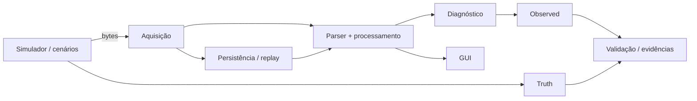

# FO-IMU Virtual Testbench

Ambiente virtual de teste, validação e diagnóstico para a interface digital da FO-IMU, desenvolvido a partir dos repositórios e materiais técnicos fornecidos pelo IEAv.

O objetivo é reproduzir o **contrato digital observado no gateway**, exercitar falhas e validar o comportamento do software antes de qualquer ensaio ativo no hardware real. O projeto não tenta simular a física completa da IMU nem substituir a validação experimental da unidade.

## Por que este projeto existe

A bancada foi criada para permitir que protocolo, aquisição, armazenamento, replay, diagnóstico e recuperação sejam estudados de forma reproduzível no PC. Isso ajuda a:

- entender o comportamento esperado da cadeia digital antes de usar o hardware;
- reproduzir erros sem colocar a unidade física em risco;
- localizar problemas por bytes, frames, eventos e épocas;
- separar o que o simulador **sabe** (`truth`) do que o software realmente **observa** (`observed`);
- testar se os próprios mecanismos de diagnóstico detectam falhas intencionais;
- preparar a comparação posterior com capturas reais da FO-IMU.

## Estado atual

| Área | Estado |
|---|---|
| Pipeline virtual de aquisição/processamento | ✅ implementado |
| Protocolo legado 53 B / parser incremental | ✅ implementado e testado |
| Replay reproduzível | ✅ implementado |
| Persistência, checkpoints e recovery | ✅ implementados |
| Injeção de falhas e cenários | ✅ implementada |
| GUI de bancada | ✅ implementada |
| Fronteira `truth` / `observed` | ✅ validada localmente |
| Semântica de counter8 e reacquisition | ✅ validada localmente |
| Semântica de estados/evidências | ✅ validada localmente |
| Corpus dourado sintético | ✅ 5 casos congelados |
| Mutation testing curado | ✅ 28/28 mutantes detectados |
| Suíte local | ✅ 162 descobertos; 158 passam sem GUI; 4 Qt aguardam ambiente gráfico |
| CI Linux + Windows + GUI (G1) | ⏳ `NOT_RUN` |
| Preparação para captura real (P3.5B) | ✅ aprovada |
| Ancoragem com FO-IMU real (G5) | ⏳ aguardando dados IEAv |
| Calibração/escala física | ⏳ não validada |
| HIL / serial físico | ⏳ fase futura |

**Importante:** resultados sintéticos demonstram consistência e capacidade de diagnóstico do testbench. Eles **não provam conformidade com a unidade física**. A próxima validação relevante é confrontar as hipóteses congeladas com bytes reais do IEAv.

## Hipóteses digitais atualmente pré-registradas

Antes de abrir qualquer captura física, o projeto congelou as seguintes hipóteses para a unidade instalada:

- frame candidato de **53 bytes**;
- header `A0 A0`;
- counter de **8 bits**;
- checksum Fletcher legado;
- taxa nominal próxima de **100 Hz**;
- campos multibyte em **little-endian**.

Elas continuam hipóteses até a etapa G5. O procedimento de ingestão e os critérios de refutação estão documentados em [HW_CAPTURE_INGESTION.md](docs/HW_CAPTURE_INGESTION.md) e [HW_CAPTURE_EXPECTATIONS.md](docs/HW_CAPTURE_EXPECTATIONS.md).

## Arquitetura em uma visão



A regra central é que `truth` não pode melhorar o caminho `observed`. O mesmo fluxo de processamento usado em execução também é usado na reanálise de capturas por arquivo.

Detalhes: [PROJECT_ARCHITECTURE.md](docs/PROJECT_ARCHITECTURE.md).

## Execução rápida

Requisito suportado nesta baseline:

```text
CPython >=3.12,<3.13
```

### Teste legado simples

```powershell
py -3.12 -m foimu_testbench demo --config configs/normal.json --out logs/demo_normal
```

### Backend v2

```powershell
py -3.12 -m foimu_testbench run-v2 --scenario configs/v2/normal.json --out logs/run_v2
py -3.12 -m foimu_testbench inspect-v2 --run logs/run_v2
py -3.12 -m foimu_testbench replay-v2 --run logs/run_v2 --out logs/replay_v2
```

### Suíte de testes

```powershell
py -3.12 -m unittest discover -s tests -v
```

Para a GUI, instale as dependências opcionais de `requirements-gui.txt`. A documentação específica está em [P3_GUI.md](docs/P3_GUI.md).

## O que já foi validado internamente

A baseline atual inclui, entre outros:

- conservação de bytes sob fragmentação e processamento;
- replay com preservação da evidência observada;
- shutdown/recovery e persistência em filas limitadas;
- counter8 com rollover, saltos ambíguos e reacquisition;
- separação estrutural entre `truth` e `observed`;
- estados `execution`, `evaluation` e `integrity` independentes;
- cobertura/evidência explícita para conclusões positivas;
- propriedades determinísticas da árvore de evidências;
- 28 mutantes curados para validar o próprio mecanismo de verificação;
- corpus dourado com normal, checksum corrompido, counter ambíguo, mudança de época e cauda truncada;
- dry-run completo do procedimento de recebimento e análise de uma captura externa.

O status detalhado, incluindo limites de cada claim, está em [STATUS.md](docs/STATUS.md).

## Próxima etapa: dados reais

A preparação P3.5B está concluída. O próximo gate científico é **G5**, usando capturas brutas da FO-IMU real sem alterar previamente o parser para fazê-las “passar”.

O pedido preparado ao IEAv prioriza:

1. captura estática;
2. captura desde o power-on;
3. posteriormente, movimento conhecido por eixo;
4. reconexão somente se autorizada.

Cada divergência será classificada por escopo (`PARSER`, `FIRMWARE`, `TRANSPORT`, `CAPTURE_ARTIFACT` ou `UNKNOWN`) antes de qualquer correção.

## Limites atuais

Este projeto ainda **não afirma**:

- calibração física dos canais;
- precisão da FO-IMU;
- sincronismo físico entre sensores;
- jitter interno do sensor a partir de timestamps do host;
- conformidade da unidade real com o layout digital pré-registrado;
- robustez de um enlace serial físico/HIL ainda não integrado.

## Documentação principal

- [Status atual](docs/STATUS.md)
- [Arquitetura](docs/PROJECT_ARCHITECTURE.md)
- [Roadmap](docs/ROADMAP.md)
- [Backend P2](docs/P2_BACKEND.md)
- [GUI P3](docs/P3_GUI.md)
- [Truth boundary](docs/TRUTH_BOUNDARY.md)
- [Counter semantics](docs/COUNTER_SEMANTICS.md)
- [State/evidence semantics](docs/STATE_SEMANTICS.md)
- [Trusted Computing Base](docs/TRUSTED_COMPUTING_BASE.md)
- [Plano de CI](docs/CI_PLAN.md)
- [Ingestão de captura física](docs/HW_CAPTURE_INGESTION.md)
- [Expectativas para captura física](docs/HW_CAPTURE_EXPECTATIONS.md)
- [Política de dados externos](docs/EXTERNAL_DATA_POLICY.md)

## Proveniência e publicação

Parte da documentação histórica foi construída a partir de materiais de firmware fornecidos pelo IEAv. O escopo de publicação desses materiais está sendo tratado separadamente; capturas reais e novos materiais externos não devem ser publicados automaticamente.

O testbench preserva a proveniência das referências utilizadas e mantém separado o que é hipótese, observação, truth sintético e evidência externa.
