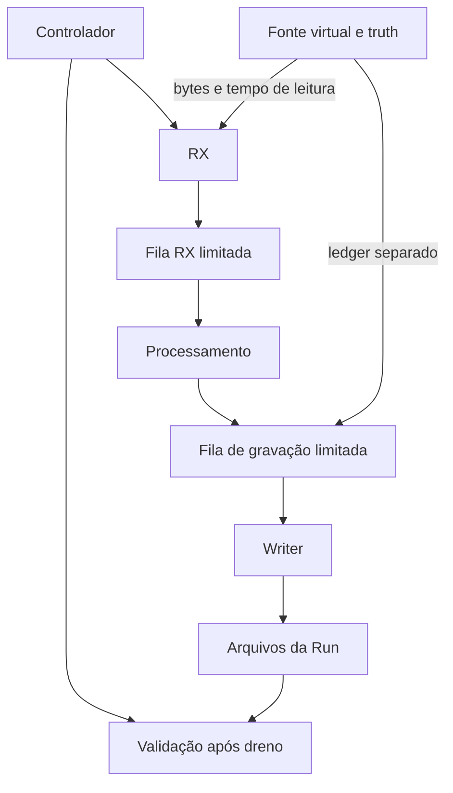

# P2: backend headless e evidências

Escopo: aquisição virtual L1 e reprocessamento de Runs v2. Sem GUI, Qt, COM,
hardware, modelos físicos, scripting arbitrário ou início de P3.

Base de desenvolvimento: `origin/main` em
`d23f4eab71276e082eca604022a443205a92cb24`, merge da P1. O contrato binário
continua `gateway53-fletcher16-le-v1`. A versão do aplicativo permanece 0.1.0;
P2 não é uma publicação da v0.2 completa. Schemas de contratos e registros têm
`schema_version: 2`. Mudanças aditivas desta etapa são lidas pelo leitor P2;
o leitor estrito da P1 não promete ler os campos adicionais da P2.

## Uso no PC

Python >=3.11 e biblioteca padrão. Nenhuma dependência adicionada. Python 3.12/Linux
foi exercitado; execução no Windows permanece uma validação necessária.

Na raiz do repositório, em uma pasta de saída que ainda não exista:

```powershell
py -3 -m foimu_testbench run-v2 --scenario configs/v2/normal.json --out logs/p2_normal
py -3 -m foimu_testbench inspect-v2 --run logs/p2_normal
py -3 -m foimu_testbench replay-v2 --run logs/p2_normal --out logs/p2_replay
```

Importação explícita da configuração antiga:

```powershell
py -3 -m foimu_testbench run-v2 --config-v1 configs/checksum.json --out logs/p2_checksum
```

Essa importação não inventa critérios. `completed` com `not_evaluated` significa
execução concluída e nenhuma aprovação atribuída. O exemplo v2 normal contém
critérios propostos para a bancada: 6000 frames, zero lacunas candidatas, zero
checksum e zero framing. Não são requisitos físicos ou aeroespaciais.

Inspeção de execução interrompida e reanálise com override:

```powershell
py -3 -m foimu_testbench inspect-v2 --run logs/interrompida --recover
py -3 -m foimu_testbench replay-v2 --run logs/p2_normal --rate-hz 50 --out logs/reanalise_50
```

A recuperação apenas lê e informa prefixos/caudas; não reescreve a origem.
Override muda a análise, não a captura, e é registrado em `derivation.json`.
Os comandos v1 `demo`, `simulate`, `acquire` e `replay` mantêm seus runners.

Códigos de saída v2: 0 para execução/registro completos sem reprovação, inclusive
`not_evaluated`; 2 para entrada/preparação inválida; 3 para falha operacional,
registro incompleto ou inspeção com problemas; 4 para avaliação reprovada ou
inconclusiva de execução completa; 130 para cancelamento. O JSON de saída sempre
explicita os três estados. Código 0 sozinho não significa ensaio aprovado.

## API e responsabilidade dos módulos

```python
from pathlib import Path
from foimu_testbench.backend import RunController, BackendOptions
from foimu_testbench.scenarios import load_v1

controller = RunController(
    load_v1('configs/normal.json'),
    Path('logs/api_p2'),
    options=BackendOptions(),
)
run = controller.execute()
```

`execute()` ocupa o chamador até finalizar. Outro chamador/thread pode usar
`request_stop(command_id, reason)` enquanto a execução estiver ativa. P2 não
implementa serviço IPC para GUI. O processo CLI já é independente de qualquer
janela; P3 deverá adicionar um cliente e um serviço de controle sem colocar a
GUI no caminho de aquisição.

| Módulo | Responsabilidade |
|---|---|
| `backend.py` | RunController, BackendOptions, filas limitadas, saúde e shutdown |
| `evidence.py` | Envelopes de bytes imutáveis e schemas de chunks/frames |
| `processing.py` | Proprietário único do parser, counter, estatísticas e watchdogs de dados |
| `emission.py` | Fonte synthetic_v1, fragmentação e ledger fora do SUT |
| `storage.py` | RunWriter, manifesto, checkpoints, RunReader e recuperação somente leitura |
| `validation.py` | Registro explícito de métricas/unidades e avaliação de critérios |
| `reporting.py` | Relatório pt-BR derivado das evidências |
| `replay.py` | Reprocessamento com configuração de origem e override rastreável |
| `cli_v2.py` | Entradas v2, validação e códigos de saída |

Não houve movimentação de arquivos legados por estética.

## Workers e fronteiras



Um processo, thread chamadora do controlador e três threads de trabalho. O writer
não executa parsing. O controlador não chama o parser. Processamento é proprietário
único do parser e do counter. O SUT recebe somente bytes, épocas e tempos do
adaptador, mais taxa/política declaradas; não recebe ledger ou índices de emissão.

`LocatedParser` herda o parser legado, intercepta `_discard` e anota os `Packet`
que o `feed()` original produz. Não há uma segunda implementação da seleção de
frames. O avanço por um byte, headers sobrepostos, limites de buffer e contagens
legadas são preservados. A associação usa offsets observados, não counter8.

Snapshots de Scenario/BackendOptions atravessam a fronteira como JSON UTF-8 em
`bytes`. Chunks têm bytes imutáveis e metadados serializados; lotes do writer são
tuplas de registros com corpo `bytes`. Não são compartilhados dicionários ou
listas da configuração original. A P1 continua com dataclasses superficialmente
frozen, mas essa mutabilidade não atravessa os workers.

## Agendamento virtual e backpressure

Defaults de `BackendOptions`, persistidos em `backend.resolved.json`:

| Parâmetro | Default | Significado |
|---|---:|---|
| `rx_bytes` | 8 MiB | Soma de bytes de dados e metadados serializados em espera |
| `writer_bytes` | 8 MiB | Soma dos corpos serializados em espera |
| `queue_items` | 16384 | Limite adicional por fila |
| `barrier_every` | 128 | Leituras entre barreiras no modo virtual |
| `checkpoint_every` | 128 | Lotes escritos entre checkpoints |
| `worker_timeout_ns` | 5 bilhões | Prazo monotônico sem progresso de worker |
| `shutdown_timeout_ns` | 5 bilhões | Orçamento de dreno/join por fase de encerramento |
| `record_emissions` | true | Registro por emissão, além de faults e resumo |
| `scheduling` | virtual_barriers | Avanço virtual por lotes |

As filas não esperam espaço em `put`: recusam explicitamente com `Overload`.
Nenhum item antigo é removido para acomodar um novo. Registra-se fila, limites,
tamanho/pico, bytes e itens enfileirados, peso rejeitado, worker e instante.
A fila mede payload serializado, não RSS Python. Há ainda um item em serviço por
worker, buffers limitados do parser e até 64 comandos registrados.

O modo `virtual_barriers` espera o processamento e a gravação dos lotes antes de
avançar a fonte virtual. Isso garante lógica determinística e memória limitada,
mas não mede capacidade sustentada. Não há um dispositivo físico emitindo durante
essa espera. Em `unpaced_stress`, a fonte não usa as barreiras e a saturação é um
resultado esperado. Não interpretar desaceleração do produtor como taxa suportada.

O teste de writer lento usa uma barreira de teste com Events, sem inferir prazo
por sleeps. RX pode continuar até o limite/barreira enquanto o writer está parado.
O tempo de parede de uma Run virtual é apenas custo desta execução, sem garantia
hard-real-time. O SUT nunca recebe o tempo sintético como amostragem física.

`resource_limits.max_memory_bytes` é recusado nesta fase: não existe limitador de
RSS do processo. Os limites das filas são os efetivamente implementados.
`max_disk_bytes` é um orçamento de disparo de parada: verifica append, tamanho
total nos checkpoints e projeção de run.json na finalização. Não é quota física
do filesystem. Metadados e registro de emergência podem ultrapassar o orçamento
entre verificações; ultrapassagem detectada impede completed/complete. Uma quota
de volume e reserva de espaço precisam de validação antes de uso prolongado.
Limites de memória/durabilidade não são requisitos da FO-IMU.

## Ciclo de vida e Stop

Caminho normal: draft, validated, prepared, armed, running, stopping, finalizing,
completed. Estados são registrados em `control/actions.jsonl`; a preparação da
transição terminal fica em `storage/terminal.jsonl` com `committed_by: run.json`.
O controlador permanece publicamente em finalizing até confirmar os artefatos e
substituir run.json. Um journal terminal preparado, isoladamente, não prova
conclusão. Falha nesse ponto produz failed/partial e tenta corrigir relatório e
avaliação, sem conservar aprovação anterior. Nenhuma comparação usa
`completed == passed`.

Uma razão já registrada não é apagada por `transition(..., reason=None)`.
Uma razão nova explícita substitui a anterior, por exemplo falha durante dreno.
O motivo solicitado pelo operador permanece no journal do comando.

Stop contém ID, razão, instante monotônico, ACK e resultado efetivo terminal.
O mesmo ID retorna o ACK original com indicação de duplicata; não reaplica Stop.
Pedidos novos após um Stop aceito são recusados. ACK confirma recepção pelo
controlador, não durabilidade no disco. O registro é encaminhado ao writer; se
este falhar, tenta-se registrar os comandos e o erro no journal terminal separado.

Ordem de shutdown: interromper novas leituras, permitir que o chunk em andamento
seja encaminhado, concluir RX, drenar processamento, registrar stopping/finalizing,
fechar entrada do writer, drenar e fechar arquivos. Após joins, identidade final,
avaliação, relatório e manifesto. Parada solicitada com dreno íntegro pode ser
`cancelled/complete`, mas não `passed`.

Falha de fila ou armazenamento solicita Stop e impede integridade completa.
Writer que lança exceção é encerrado, os handles são fechados e o prefixo anterior
permanece. Uma thread presa dentro de I/O do SO não pode ser morta com segurança:
o controlador respeita prazos, marca `aborted/partial` e informa workers vivos.
As threads são daemon para permitir término do processo CLI. Recuperação posterior
é conservadora; não há garantia de fechamento de I/O travada em nível de kernel.

## Persistência

| Artefato | Conteúdo |
|---|---|
| `run.json` | Estado, identidades inicial/final, clocks, critérios, resultado e manifesto |
| `scenario.resolved.json` | Receita inicial imutável, seed, perfil e proveniência |
| `backend.resolved.json` | Filas, barreiras, checkpoint e limites operacionais |
| `derivation.json` | Somente replay: origem, hashes e diferenças explícitas |
| `control/actions.jsonl` | Transições, pedido e ACK de Stop |
| `observed/wire.bin` | Bytes recebidos exatos, inclusive lixo e corrupção |
| `observed/chunks.jsonl` | Leitura, tick, época e fim; offsets, tamanhos, seq, clock, tempo e SHA-256 por chunk |
| `observed/frames.jsonl` | Campos decodificados, counter, intervalo de 53 B, refs aos chunks e integridade do frame |
| `observed/events.jsonl` | Candidato rejeitado, descarte e resync com spans |
| `truth/faults.jsonl` | Aplicações, supressões e ações não alcançadas |
| `truth/emissions.jsonl` | Opcional: oportunidades, modelo, tempos e hashes antes/depois |
| `truth/summary.jsonl` | Resumo produzido pela fonte, incluindo se chegou ao fim |
| `diagnostics/events.jsonl` | Descontinuidades e watchdogs, sem certeza causal inventada |
| `diagnostics/metrics.json` | Métricas e estatísticas por canal, incluindo valores desconhecidos |
| `system/pipeline.json` | Filas, picos, pendências, erros e workers ainda vivos |
| `validation/results.json` | Resultado e razão de cada critério |
| `storage/checkpoints.jsonl` | Prefixos sincronizados, geração, tamanhos e hashes |
| `storage/terminal.jsonl` | Transição terminal preparada, comandos e falhas; confirmação em run.json |
| `storage/finalization_error.jsonl` | Opcional: falha ao confirmar os artefatos finais |
| `report.md` | Relatório derivado, eventos selecionados e limites |

Só são criados arquivos efetivamente utilizados. Zero bytes recebidos pode produzir
índice com época/fim e nenhum wire.bin. Sem falhas, faults/events podem estar ausentes.
NaN/Inf permanecem nos bytes; em frames JSON usam `null` com `numeric_status`
`nan`, `pos_inf` ou `neg_inf`. Não são convertidos em zero.

`byte_span` usa [start,end), sem incluir end. `global_offset` é o offset em wire.bin,
monotônico entre épocas; `read_seq` enumera também ticks, épocas e fim. Cada frame
usa o timestamp do chunk que completou sua recepção. A resolução do formato em ns
não afirma resolução física. L1 converte tempos legados em segundos para ns com
`round`: quantização de até 0,5 ns relativamente ao valor computado em ponto
flutuante, além do erro desse cálculo. Isso não caracteriza precisão física.
Quando uma nova época descarta bytes parciais antigos, o evento mantém a época
desses bytes e usa o instante da nova leitura como tempo de detecção. Replay
preserva essa separação, offsets globais e referências aos chunks.

O writer grava bytes antes de seu índice, depois os derivados do lote. Checkpoint
só é publicado após flush/fsync dos arquivos referenciados. Seus hashes cobrem
prefixos, não promessas sobre o futuro. Arquivos JSON de estado usam temporário
no mesmo diretório e `os.replace`. JSONL é append-only. A raiz é exclusiva e
qualquer diretório existente é recusado.

Ao finalizar, o manifesto registra tamanho e SHA-256 dos artefatos existentes.
run.json não possui auto-hash; o relatório não inclui seu próprio hash, que fica
no manifesto. Hash comprova coerência com o manifesto, não autenticidade física.
A finalização não é uma transação atômica entre todos os arquivos. fsync dos
arquivos não implica sincronização de diretório, cache do dispositivo ou proteção
contra queda elétrica. Windows/antivírus/driver precisam de ensaios específicos.

## Recuperação e replay

O leitor verifica manifesto, schema, ordem de leituras, continuidade de offsets,
limites do wire, hashes de chunks, épocas únicas declaradas, clock, monotonicidade
e exatamente um fim sem registros posteriores. Mesmo um manifesto refeito não
elimina a validação estrutural da timeline.

Checkpoint: varrer a sintaxe do journal uma vez e verificar o checkpoint mais
recente. Se ele não puder provar seus prefixos, procurar o anterior. Guardam-se
posições dos registros para evitar rehash quadrático na abertura normal. Sintaxe
ou estrutura inválida da cauda, inclusive tipo errado ou schema_version booleano,
não apaga o último prefixo válido. Essas posições usam memória proporcional ao
número de checkpoints durante a inspeção offline.
Há custo de I/O para verificar a captura integral; não é um índice de navegação.

Uma execução sem estado terminal é apresentada como `interrupted_recovered`,
integridade parcial e nenhuma aprovação. O último prefixo confirmado e as caudas
são expostos separadamente. Nada é truncado, apagado ou corrigido na origem.
Metadados mínimos ausentes/corrompidos podem impedir a construção de uma Run;
o leitor informa erro em vez de inventar Scenario ou identidade.

Replay fiel exige Run íntegra e timeline válida, carrega Scenario de origem e
produz uma Run filha. Reprocessa os mesmos bytes e tempos por meio dos mesmos
workers. Override de taxa cria `derivation.json`; não altera origem nem finge que
a taxa do dispositivo mudou. Truth de origem não é repassado ao SUT; critérios
truth sem referência disponível ficam inconclusivos. P2 não faz replay temporal
por socket, seek/indexação, comparação A/B completa ou leitura de capturas v1
pelo leitor v2. O replay v1 permanece disponível na CLI antiga.

## Truth, métricas e conclusões

O gerador chama o Injector legado uma vez por oportunidade. O ledger registra a
ordem jitter, drop, checksum, byte, header, truncamento. Regras selecionadas depois
de um drop ficam `suppressed`, mantendo sua contagem legada sem aplicação.
Cada ocorrência guarda regra, oportunidade, parâmetros, ordem, resultado e hashes.
O gerador verifica que a reconstrução anotada produz exatamente os bytes do Injector.
Ações declarativas de habilitação são ordenadas por oportunidade e sequence_id;
ações posteriores ao encerramento ficam `not_reached`.

Não se grava um evento para cada regra que não foi selecionada em cada oportunidade;
a configuração e o índice permitem reconstruir essa seleção. O resumo da fonte
marca execução parcial em Stop. Funções/hook de teste fornecidos pela API não são
serializados como scripts; a Run registra essa limitação quando usados.

Métricas observadas não incluem `packets_expected`. Planejamento está no Scenario;
quantidades do injetor ficam em truth. `packets_lost` conserva a política legada de
lacuna candidata e pode ser zero diante de um drop final conhecido por truth.
Não se soma erro de checksum, framing e resync como falhas físicas independentes.

Watchdogs distintos:

- `byte_silence`: ausência de bytes no domínio de recepção.
- `valid_frame_silence`: ausência de frame aceito, mesmo com lixo contínuo.
- `worker_progress`: prazo monotônico de resposta/progresso do worker.

Os dois primeiros usam o clock virtual/ticks da captura e registram deadline,
detecção e atraso real nesse domínio. O terceiro usa monotônico local do host.
Não existe timeout de IFOG/ACC/MEMS inferido desses watchdogs.

O registro de critérios em `validation.py` declara domínio, unidade e denominador.
Contagem de frames em janela encerrada tem uma evidência de janela, permitindo
reprovar `frames_accepted >= 1` quando houve zero frames. Erros de checksum usam
bytes como cobertura; jitter usa intervalos válidos em quantidade suficiente.
Unidade/métrica desconhecida ou integridade parcial gera inconclusivo.
Acesso a truth ocorre somente no ramo de critério cujo domínio é `truth`.
Sem critérios: `not_evaluated`. Cancelamento não aprova a execução completa planejada.

Identidade inicial é preservada. A final inclui hashes de pacote, testes, configs,
tools e arquivos de projeto; comparação sinaliza alteração de hash ou commit.
O repositório não é bloqueado. Duas coletas não detectam edição transitória que
foi revertida entre ambas, nem constituem snapshot atômico de código carregado.
Mudança detectada recebe ressalva de reprodutibilidade, sem falsificar a identidade.

## Diferenças explícitas em relação ao plano

| Questão e evidência | Escolha P2 | Impacto |
|---|---|---|
| Plano permite execução virtual síncrona, mas a tarefa pede desacoplamento e writer lento | Três threads, com barreiras explícitas no modo virtual e stress sem barreiras | Exercita isolamento e filas; não prova taxa sustentada |
| Primeiro slice do plano menciona TCP; gate desta etapa exige virtual | CLI/API v2 virtual e replay; TCP v1 preservado, Scenario TCP recusado no executor v2 | Captura TCP v2 e integração IPC ficam posteriores, declaradas como lacunas |
| Checkpoint sugerido por tempo real de 1 s | Intervalo por número de lotes, default 128 | Reprodutível e rápido em tempo virtual; sem promessa de máximo temporal de perda |
| P1 somente tem um timeout de stream | Mesmo limiar configurado para byte/frame, worker com limiar próprio | Distingue mecanismos; configuração de limiares separados de byte/frame fica posterior |
| Limite de RSS seria garantia inexistente | Recusar max_memory_bytes; expor filas limitadas | Sem falso limitador de memória total |
| Python não cancela uma thread presa em I/O com segurança | Prazo, estado aborted/partial e registro de workers vivos | Sem promessa de recuperar I/O travada no mesmo processo |
| Manifesto tem raiz e relatório derivado | Sem auto-hash de run.json/report.md no próprio conteúdo | Evita ciclo de hashes; integridade por manifesto, sem assinatura |
| Zero frames pode ser resultado observado de uma janela inteira | Evidência de janela no critério de quantidade | Zero dados não vira sucesso implícito |

`PLANO_V02.md` não foi alterado para esconder essas decisões. P3 não foi iniciado.

## Achados B01 a B14

| ID | Classificação P2 | Evidência e limite |
|---|---|---|
| B01 | corrigido no caminho v2 | RX, processamento e writer separados; teste de writer bloqueado com RX avançando; modo virtual usa barreiras declaradas |
| B02 | parcialmente mitigado | Metadados prévios, checkpoint, manifesto e recuperação; sem garantia de queda elétrica ou I/O de kernel travada |
| B03 | corrigido no caminho v2 | Validação de offsets, épocas, clocks, fim e regressão temporal antes de replay |
| B04 | corrigido no caminho v2 | Scenario de origem obrigatório; override explícito em Run filha |
| B05 | corrigido no caminho v2 | Execução/avaliação/integridade independentes; zero frames reprovável com critério |
| B06 | parcialmente mitigado | acceptance_p2 usa verificações não removíveis por -O e mínimo de testes; ferramenta legada intacta |
| B07 | corrigido no caminho v2 | Spans e refs por frame/candidato/descarte/resync, com equivalência de Packet |
| B08 | corrigido no caminho v2 | Ledger por aplicação/supressão e ações não alcançadas; composição v1 mantida |
| B09 | corrigido no caminho v2 | Expected fora de observed; truth só na trilha/validação explícita |
| B10 | parcialmente mitigado | Identidade inicial/final e mudança de fontes; sem lock/snapshot atômico |
| B11 | pendente | Manifesto histórico de distribuição não regenerado; Runs novas têm manifesto próprio |
| B12 | corrigido no caminho v2 | Watchdogs separados e atraso de detecção registrado |
| B13 | pendente | Política de reconexão/burst TCP legada não alterada; sem TCP v2 |
| B14 | corrigido no caminho v2 | Importador/contratos estritos da P1 mantidos; bool não é versão inteira |

Classificações não atribuem correções ao firmware original nem ao caminho v1.
As limitações da FO-IMU física permanecem as da auditoria de Fase 0.

## Correção posterior ao gate original: orçamento de shutdown

O gate original da P2 não cobria o consumo acumulado dos joins. Um teste com
workers simulados e relógio controlado confirmou o deadline compartilhado:
com T=1 s, RX consumia 0,9 s, processamento recebia apenas 0,1 s e writer
recebia zero. O estado resultante era aborted/partial.

Agora shutdown_timeout_ns define orçamento independente para cada join final:
RX recebe T; processamento recebe T; após fechar a entrada do writer, seu join
recebe T. Tempo consumido em uma fase não reduz o orçamento da seguinte.
O teste corrigido simula RX e processamento consumindo 0,9 s cada e writer
saudável drenando em 0,5 s. A interrupção solicitada termina cancelled/complete,
sem falsa classificação aborted/partial. Não usa sleeps nem threads reais.

A janela de observação após Stop no loop ativo continua separada dos joins e
limitada por T. Assim, T não é limite total do execute: podem existir essa janela,
até três esperas finais de T e o trabalho de finalização. O timeout limita espera
por worker; não cancela I/O do kernel nem limita fsync/relatório/identidade.
Workers ainda vivos após os joins continuam produzindo aborted/partial.
