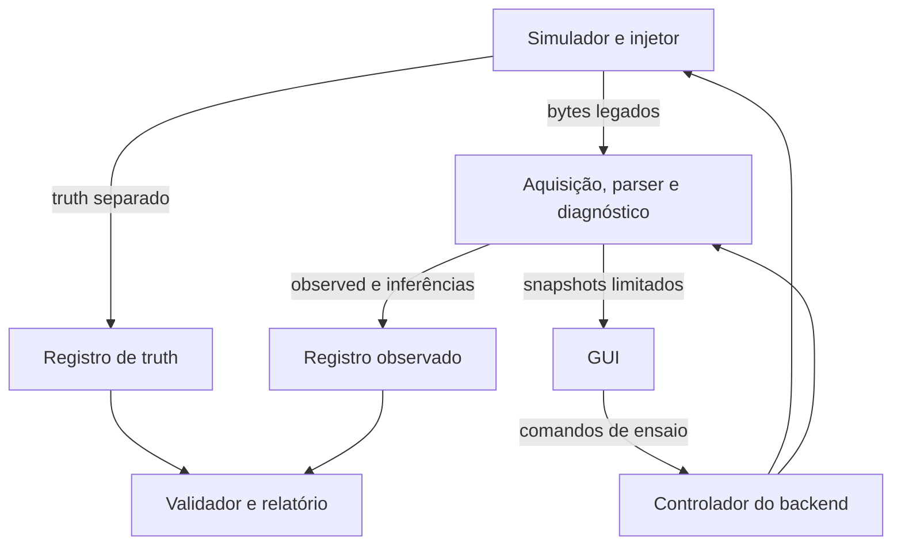

# Plano técnico da v0.2

Estado: proposta para implementação posterior. Esta etapa altera somente este documento.

## 1. Resumo e baseline auditada

A v0.1.0 já fornece o caminho que precisamos preservar: gerar bytes conhecidos, recebê-los sem acesso às respostas do simulador, interpretar, registrar e medir. A v0.2 deve colocar esse caminho dentro de um ensaio identificável, observável e recuperável. A interface gráfica será um cliente desse ensaio, não seu motor.

Uma comparação com instrumentação: o simulador é a fonte de sinal conhecida; a aquisição é o instrumento sob teste; o validador compara referência e resultado. O instrumento não pode consultar a referência para decidir quais bytes aceitar. Fechar a janela do gráfico não deve desligar o instrumento nem o gravador.

### Identidade da referência

| Item | Evidência verificada |
|---|---|
| Repositório | [artorias09/foimu-testbench-v1](https://github.com/artorias09/foimu-testbench-v1) |
| Branch limpa de referência | `chore/baseline-cleanup` |
| Commit congelado | [`52531eaa16bb111cdb6ad862c8fd037d6ead0977`](https://github.com/artorias09/foimu-testbench-v1/commit/52531eaa16bb111cdb6ad862c8fd037d6ead0977), mensagem `Match original v0.1.0 baseline` |
| Árvore Git | `b68fd839860c8e84b0d002d5d9dcfeddbee9690b` |
| `main` consultada | `36992550ad70fc83bc14f3e422aff43dde71b319`, merge do PR 1; mesma árvore da referência |
| Versão declarada | `0.1.0` no pacote e em `pyproject.toml` |
| Perfil binário | `gateway53-fletcher16-le-v1` |
| Hash Python reproduzido | `267ab905a2e0132fc5062d57c52bf8c2f3c707e347322ed5efeea31f8beff25a` |
| Ambiente desta auditoria | Python 3.12.14, Linux 6.18.55 x86_64, glibc 2.39 |
| Data de referência da auditoria | 29/10/2026, America/Sao_Paulo; commits perto da meia-noite aparecem como 30/10 em UTC |

O histórico contém uploads sucessivos, uma estrutura anterior com código na raiz, caches e logs versionados, a limpeza `bc0da88`, o ajuste `52531ea` e o merge `3699255`. As branches `configs` e `revert-1-chore/baseline-cleanup` também existem; a última aponta para `4543425`, que reverte a limpeza, e não foi usada como baseline. Não há tag v0.1.0 no clone examinado. Portanto a referência reproduzível é o SHA acima, não apenas o nome da versão ou da branch.

O clone estava limpo antes da auditoria. A branch local de trabalho é `docs/plano-v02`, criada a partir da referência. Os originais do IEAv não foram modificados.

### Validação repetida nesta etapa

Executado, sem alterações no código:

```text
python -m tools.acceptance --out <diretorio-novo-fora-do-repositorio>
```

| Verificação | Resultado desta execução |
|---|---|
| Suíte unitária e integração TCP | 33 testes passaram |
| Normal acelerado | 1.000.000 recebidos, 0 perdas candidatas, 0 checksum, 0 framing |
| Pico do buffer no ensaio normal | 53 bytes |
| Suíte, milhão e cenários | 23,530 s de parede; não comparar desempenho com outra máquina sem controle |
| Checksum, byte e truncamento, 1001 oportunidades cada | 901 aceitos, 100 lacunas, 101 candidatos inválidos, 100 ressincronizações |
| Header, 1001 oportunidades | 901 aceitos, 100 lacunas, 1 candidato inválido, 100 ressincronizações |
| Perda, 1001 oportunidades | 901 aceitos, 100 lacunas, 0 checksum/framing |
| Jitter, 1001 oportunidades | 1001 aceitos, 0 perdas; máximo 0,0019743485263057445 s |
| Manifesto dos originais | 522 entradas lidas e conferidas contra as cópias locais, sem divergência de tamanho ou SHA-256 |
| Manifesto da distribuição | 74 entradas verificadas; somente `README.md` diverge de `SHA256SUMS.json` |

Os 101 candidatos inválidos não são 101 falhas físicas: o counter `0xA0` pode formar um header sobreposto. Os resultados coincidem com `docs/VALIDACAO.md`. O vetor C foi lido e o binário foi exercitado pelos testes; não foi recompilado nesta etapa. Não foram executados Windows, COM, ensaio real de oito horas, ESP32 ou HIL. O milhão usa `record=False`; não prova capacidade sustentada de gravação.

## 2. Estado atual e funcionalidades a preservar

| Área | Implementado na baseline | Limite real |
|---|---|---|
| Protocolo | 53 bytes, `A0 A0`, counter8, `<B3f4H7f`, Fletcher LE sobre 49 bytes | Sem timestamp físico, ID de sensor ou flags inequívocas de validade |
| Parser | Incremental, cortes arbitrários, headers sobrepostos, descarte e ressincronização, memória limitada | Retorna `Packet`; não retorna offsets nem eventos individuais de erro |
| Sinais | Seno em X, constante Y, rampa Z, ACC/tap constantes, temperaturas por slot, MEMS correlacionado | Fórmulas fixas, sintéticas; não representam física óptica |
| Configuração | JSON, defaults, seed, taxa, quantidade, fragmentação, timeout, seis controles de falha | Não há Scenario versionado nem edição durante execução |
| Falhas | Drop, XOR de checksum, XOR de byte, header, truncamento, jitter uniforme | Contagens agregadas; sem histórico de cada aplicação |
| Transporte | Virtual determinístico e TCP; reconexão e timeout de ausência de bytes | Sem COM; servidor pode esperar cliente indefinidamente e recuperar cronograma em burst |
| Diagnóstico | Counter, períodos, jitter, lacunas, estatísticas finitas, NaN/Inf, repetições, slots térmicos | Sem classificação causal, árvore ou localização por offset |
| Registro | `wire.bin`, `chunks.jsonl`, `samples.csv`, configuração e relatórios | Escrita síncrona; metadados finais dependem de `finish()` |
| Replay | Bytes e chunks com tempos; fallback temporal sintético explícito | Sem importador de Run completo, validação integral de schema ou associação de origem |
| Validação | `unittest`, fixtures C/binário/JSON, runner de aceitação | Sem CI versionada, A/B automático, profiling prolongado ou GUI |

Preservar explicitamente:

1. Perfil legado, bytes, offsets, unidades e quantização float32. Novos protocolos têm novos IDs; nenhuma extensão oculta do frame.
2. `encode`, `decode`, `Packet` e o contrato consumível de `StreamParser.feed()`, com adaptador compatível se eventos forem acrescentados.
3. Avanço de um byte após candidato inválido, preservação de headers sobrepostos e limite exercitado de 4148 bytes no teste de burst/lixo.
4. Semântica atual das métricas legadas, inclusive suas ambiguidades. Novas definições recebem versão e nome distintos.
5. Comandos CLI existentes, configurações schema 1 e importação de capturas antigas.
6. Separação entre sinais sintéticos e alegações físicas; `null` para latência física e timeout por sensor não observáveis.
7. Fixtures independentes, testes existentes, exemplos históricos e recusa de sobrescrever saída existente.
8. Core utilizável sem GUI, sem hardware e sem instalar dependências gráficas.

## 3. Problemas técnicos encontrados

As linhas abaixo referem-se exclusivamente ao commit congelado. Os links apontam para esse SHA. Prioridade P1 significa resolver antes de aceitar o primeiro slice como bancada; P2 significa evolução seguinte. Não é uma classificação de risco aeroespacial.

| ID / classificação | Evidência | Comportamento e impacto | Encaminhamento proposto |
|---|---|---|---|
| B01, CONFIRMADO PELO CÓDIGO, P1 | [`Capture.ingest`, linhas 45 a 59](https://github.com/artorias09/foimu-testbench-v1/blob/52531eaa16bb111cdb6ad862c8fd037d6ead0977/foimu_testbench/acquisition/__init__.py#L45); `runners.acquire`:123 | Escrita binária, JSONL, parser, estatísticas e CSV acontecem antes do próximo `recv`. Disco lento atrasa a leitura. Perda efetiva sob essa carga ainda não foi medida. | Separar recepção, processamento e writer com filas limitadas e política explícita de saturação. |
| B02, CONFIRMADO PELO CÓDIGO, P1 | [`Capture.__init__/finish`, 37 a 41 e 76 a 107](https://github.com/artorias09/foimu-testbench-v1/blob/52531eaa16bb111cdb6ad862c8fd037d6ead0977/foimu_testbench/acquisition/__init__.py#L76) | Configuração, hash e relatório são escritos ao final; não há checkpoint, commit de chunks ou recuperação de escrita parcial. Falha em abrir um dos arquivos pode deixar os anteriores abertos até coleta/saída. Erro no fechamento pode esconder o erro original. | Metadados antes de armar, journal, fechamento por etapas, integridade parcial e recuperação. Não prometer resistência a falta de energia antes de testar. |
| B03, CONFIRMADO PELO CÓDIGO E REPRODUZIDO, P1 | [`replay`, 141 a 181](https://github.com/artorias09/foimu-testbench-v1/blob/52531eaa16bb111cdb6ad862c8fd037d6ead0977/foimu_testbench/runners.py#L141) | Confere offsets e comprimentos lidos, mas não valida uma sessão temporal completa. Aceitou chunk em 0,02 s, `end` em 0,005 s e outro chunk em 0,01 s: status `completed`, dois frames, uma regressão de relógio. Eventos após fim e ausência de fim não invalidam a sessão. | Validador estrutural e temporal antes de replay fiel; modo de recuperação parcial separado. |
| B04, CONFIRMADO E REPRODUZIDO, P1 | Mesmo `replay`:142; [`Diagnostics`, 40 a 41 e 64](https://github.com/artorias09/foimu-testbench-v1/blob/52531eaa16bb111cdb6ad862c8fd037d6ead0977/foimu_testbench/diagnostics/__init__.py#L40) | Replay usa a configuração fornecida pelo chamador, não a configuração da captura. Captura a 50 Hz reprocessada com default de 100 Hz preservou bytes/tempos, mas jitter passou de aproximadamente 0 para 0,01 s. Isso pode ser uma reanálise legítima, porém falta indicar o desvio da configuração de origem. | Importar Run/configuração; overrides geram análise derivada com diff e outro ID. |
| B05, CONFIRMADO E REPRODUZIDO, P1 | [`acquire`, 92 a 137](https://github.com/artorias09/foimu-testbench-v1/blob/52531eaa16bb111cdb6ad862c8fd037d6ead0977/foimu_testbench/runners.py#L92) | Sem servidor, a aquisição encerra por duração como `completed`, com zero pacotes. `completed` descreve o loop, não aprovação do ensaio. `real_time_soak` depende da duração solicitada e status, sem provar cobertura útil. | Estados separados: execução, avaliação e integridade. Ausência de dados esperados falha no critério; quando não há critério, fica não avaliado/inconclusivo. |
| B06, CONFIRMADO PELO CÓDIGO, P1 | [`tools/acceptance.py`, 20 a 40](https://github.com/artorias09/foimu-testbench-v1/blob/52531eaa16bb111cdb6ad862c8fd037d6ead0977/tools/acceptance.py#L20) | Cenários adicionais são coletados sem avaliar cada resultado nesse loop; `passed=True` resume testes anteriores e asserts do normal. `assert` do milhão pode ser removido por `python -O`. `wasSuccessful()` sozinho não rejeita descoberta de zero testes. A suíte existente cobre parte desses oráculos, portanto isso não invalida os resultados reproduzidos. | Asserções de aceitação explícitas, quantidade mínima de testes e avaliação por cenário, inclusive artefatos salvos. |
| B07, CONFIRMADO PELO CÓDIGO, P1 | [`StreamParser`, 58 a 105](https://github.com/artorias09/foimu-testbench-v1/blob/52531eaa16bb111cdb6ad862c8fd037d6ead0977/foimu_testbench/protocol/gateway53.py#L58); `Diagnostics.observe`:54 a 91 | Contagens agregadas não localizam cada falha. Não há byte span do frame/candidato nem vínculo entre suspeita e chunk. | Eventos observados com offset, época, tempo, regra e referências; preservar contagens. |
| B08, CONFIRMADO PELO CÓDIGO, P1 | [`Injector.apply`, 11 a 32](https://github.com/artorias09/foimu-testbench-v1/blob/52531eaa16bb111cdb6ad862c8fd037d6ead0977/foimu_testbench/fault_injection/__init__.py#L11); `runners.demo`:31 a 34; `serve`:79 a 81 | Truth registra totais, não cada ocorrência, valor anterior, horário ou ordem. Drop retorna antes das outras mutações; composição importa. Servidor TCP imprime resumo final, mas não persiste Run de emissão. | Ledger de truth e ações aplicado fora do SUT, com ordem versionada e resultado aplicado/suprimido. |
| B09, CONFIRMADO PELO CÓDIGO, P1 | [`Capture.finish`, 84 a 96](https://github.com/artorias09/foimu-testbench-v1/blob/52531eaa16bb111cdb6ad862c8fd037d6ead0977/foimu_testbench/acquisition/__init__.py#L84); `demo`:12 | Truth já tem chave separada, mas `packets_expected` do modo demo nasce do plano do simulador e aparece em `metrics`, junto das observações. Não é inferido dos bytes. | Em schema novo, expectativa fica em planejamento/validação; alias legado conserva semântica com origem explícita. Não passar truth ao diagnóstico. |
| B10, CONFIRMADO PELO CÓDIGO, P2 | [`source_digest`, 13 a 19](https://github.com/artorias09/foimu-testbench-v1/blob/52531eaa16bb111cdb6ad862c8fd037d6ead0977/foimu_testbench/acquisition/__init__.py#L13), chamado no final | Hash cobre apenas `.py` do pacote; não inclui testes, fixtures ou ambiente. Não guarda commit/dirty. Se arquivos mudarem durante execução, hash final pode não identificar código carregado. | Snapshot de identidade no início; commit, dirty, hashes e ambiente; marcar mudança detectada. |
| B11, APARENTE INCONSISTÊNCIA DOCUMENTAL CONFIRMADA POR HASH, P2 | `SHA256SUMS.json`, entrada `README.md` | Hash da distribuição original não corresponde ao README atual do GitHub; demais 73 entradas correspondem. Não implica alteração do codec. | Manifestos de release gerados no empacotamento; evitar exigir que um manifesto histórico cubra um documento novo. |
| B12, CONFIRMADO PELO CÓDIGO, P2 | [`acquire`, 95 a 123](https://github.com/artorias09/foimu-testbench-v1/blob/52531eaa16bb111cdb6ad862c8fd037d6ead0977/foimu_testbench/runners.py#L95) | Timeout é de ausência de bytes. Lixo contínuo não dispara esse timeout; a maior lacuna válida aparece apenas no agregado. `recv` usa 50 ms, então limiar menor não significa reação nesse prazo. | Watchdogs separados para bytes, frame válido e progresso do worker, com atraso de detecção medido. |
| B13, CONFIRMADO PELO CÓDIGO, P2 | [`serve`, 52 a 75](https://github.com/artorias09/foimu-testbench-v1/blob/52531eaa16bb111cdb6ad862c8fd037d6ead0977/foimu_testbench/runners.py#L52) | Após desconectar, espera cliente e mantém origem do cronograma; pode emitir burst. Falha de `sendall` não registra exatamente o prefixo entregue. | Política de atraso explícita; registrar tentativa e resultado de envio, sem chamar escrita TCP de recepção. |
| B14, CONFIRMADO E REPRODUZIDO, P2 | [`validate_config`, 31](https://github.com/artorias09/foimu-testbench-v1/blob/52531eaa16bb111cdb6ad862c8fd037d6ead0977/foimu_testbench/config.py#L31) | `schema_version=True` é aceito por igualdade com 1. Outros campos numéricos têm checagem de tipo mais estrita. | Schema v2 estrito; manter importador v1 que registre normalização. |

Lacunas de escopo, não bugs: GUI, comandos interativos, amplitudes configuráveis, modelos de subsistema, HIL, árvore e sweep ainda não existem. `pyproject.toml` não define um processo de distribuição completo; uso pelo diretório está documentado e funciona. Empacotamento/instalação precisa de teste próprio antes de prometer um executável Windows.

Nenhum problema desta tabela foi corrigido nesta etapa. Sinais de falha já descritos em `AUDITORIA_FASE_0.md` pertencem aos snapshots do IEAv, não são defeitos automaticamente atribuíveis ao testbench.

## 4. Arquitetura proposta e níveis de fidelidade

**Decisão proposta:** evolução por adaptação, sem reescrita do codec. O perfil de bytes é independente do nível de fidelidade, da versão do aplicativo e do schema de armazenamento.

| Nível | Afirmação permitida | Evidência necessária |
|---|---|---|
| L0, contrato de bytes | Layout e regras de aceitação compatíveis com o snapshot | Vetor C, parser e fixtures |
| L1, fluxo digital sintético | Valores/ordem/falhas digitais controlados | Seeds, ledger, captura e oráculos digitais |
| L2, comportamento temporal e de protocolo | Modelo explícito de pedidos, caches, timeout e scheduler de uma revisão | Rastreamento até código e testes do modelo; timing não medido permanece hipótese |
| L3, subsistemas | Blocos independentes com modelos e estados próprios | Contratos por revisão; parâmetros sintéticos ou medidos identificados |
| L4, interface em hardware emulado | Bytes e timing de interface produzidos por ESP32 ou outro emulador | Captura elétrica, recursos e revisão confirmados; sem alegação de física óptica |
| L5, HIL parcial | Pelo menos um bloco real integrado aos emulados | Topologia de quais blocos são reais, builds, clocks e evidência de bancada |
| L6, FO-IMU real | Dados do instrumento identificado | Revisão física, configuração, calibração e captura documentadas; presença de hardware não prova toda especificação |

Não é uma escala única de qualidade. Um ensaio pode ser L5 no gateway e L1 no ACC, com fidelidade elétrica desconhecida. `Run.fidelity` guarda nível por bloco, dimensões `bytes`, `timing`, `electrical`, `sensor_model`, evidências e limitações. A v0.1.0 cobre L0 e L1 no contrato externo, com TCP real no host; não executa firmware original. O primeiro slice permanece nesse escopo.

Não criar um pacote de 53 bytes diferente para inserir metadados. IDs largos, truth e relógios vivem nos arquivos/canal de controle. O canal de dados legado não conhece esses campos.

## 5. Módulos e responsabilidades

Cada responsabilidade será extraída quando tiver um consumidor real. Inicialmente um arquivo Python pode ser suficiente; não criar pastas vazias.

| Módulo lógico | Responsabilidade e contrato | Evolução da baseline |
|---|---|---|
| `core` | IDs, relógios, estado de Run, envelopes imutáveis, controle de ciclo de vida | Novo, sem Qt e sem detalhes de sensores |
| `protocol` | Perfis, codec e parser; `bytes -> packets/events` | Preservar `gateway53.py`; acrescentar observação de offsets compatível |
| `simulator` | Gerar valores e oportunidades; produzir truth no seu domínio | Envolver `FakeFOIMU`; fórmulas v1 permanecem selecionáveis |
| `acquisition` | Adaptadores de bytes, épocas, timestamps de recepção | Separar transporte do atual `Capture` gradualmente |
| `fault_injection` | Transformações externas ao SUT e ledger de aplicação | Manter semântica v1 como perfil de composição |
| `scenarios` | Validar, resolver e agendar Scenario; ações de controle | Evolução de `config.py`, importador schema 1 |
| `diagnostics` | Derivar fatos, suspeitas e métricas exclusivamente de observed | Reutilizar `Moments` e política counter8 versionada |
| `validation` | Oráculos e comparação explícita truth/observed/expectativas | Nunca importado pelo parser para aceitar dados |
| `storage` | RunWriter/RunReader, commits, integridade, recuperação | Extrair persistência de `Capture` |
| `replay` | Alimentar SUT com captura ou reapresentar resultados | Extrair `runners.replay`, mantendo wrapper CLI |
| `reporting` | Gerar `report.md`, JSON e pacote de diagnóstico a partir dos registros | Separar de `Capture.finish` |
| `provenance` | Reference, Provenance e identidade de código/perfis | Reutilizar manifesto como fonte histórica, sem reescrevê-lo |
| `gui` | Configuração, gráficos, eventos e comandos ao backend | Posterior; nenhuma dependência inversa do backend |
| `scripting` | Cliente isolado da API de controle com limites | Futuro; não criar agora |

Interfaces propostas: `Transport.read() -> ObservedChunk`; `Parser.feed(chunk) -> observações`; `Diagnostics.consume(observation)`; `RunWriter.append(record)`; `RunController.submit(command) -> acknowledgement`; `Validation.evaluate(run) -> resultados`. Detalhes de classes podem mudar, mas essas fronteiras não.

## 6. Fluxo de dados e fronteira do sistema sob teste



O SUT mínimo é aquisição + parser + diagnóstico. Recebe bytes, época, tempos do adaptador e eventos reais de conexão. Não recebe índice de emissão, lista de perdas ou valor ideal. Canal nominal, política diagnóstica e taxa configurada são parâmetros conhecidos, registrados como tais; não são observações do sensor.

Truth vai ao registro e ao validador, por outro caminho. A GUI pode exibir ambos, em vistas claramente identificadas, mas não deve fundi-los numa única série sem legenda. Mudar truth mantendo bytes/tempos iguais não pode alterar o resultado observed: isso será um teste de arquitetura.

Quando o SUT futuramente for um gateway real, a fronteira se move para suas interfaces de subsistemas. Registrar essa topologia na Run; não confundir um modelo Python do gateway com execução do STM32.

## 7. Modelo de execução de um ensaio

Estados propostos: `draft -> validated -> prepared -> armed -> running -> stopping -> finalizing -> completed`. Saídas alternativas: `cancelled`, `failed`, `aborted`; interrupção inesperada descoberta na reabertura vira `interrupted_recovered`. Uma desconexão de transporte é evento/estado do enlace e não termina necessariamente a Run.

1. Resolver configuração e checar capacidades do profile, sem abrir hardware.
2. Criar diretório exclusivo, salvar Scenario resolvido, identidade, critérios e orçamento de recursos.
3. Preparar writer, clocks e processos; verificar que os receptores necessários estão prontos.
4. Armar e registrar uma origem temporal. No primeiro slice TCP, iniciar emissor após receptor pronto; não contabilizar espera indefinida como aquisição aprovada.
5. Rodar até limite explícito de oportunidades/duração, cancelamento ou falha fatal. Definir política de cauda para observar última lacuna.
6. Encerrar geração, drenar transporte por prazo configurado, finalizar parser e fila de gravação.
7. Consolidar hashes, integridade, oráculos, métricas e `report.md`. Só então declarar finalização.

Três eixos independentes:

| Eixo | Exemplos |
|---|---|
| `execution_status` | Em execução, concluída, cancelada, falhou, recuperada após interrupção |
| `evaluation_status` | Aprovada, reprovada, inconclusiva, não avaliada |
| `integrity_status` | Completa, parcial, corrompida, desconhecida |

Cancelar não equivale a reprovar o dispositivo. Receber zero frames não equivale a aprovar comunicação. Sem oráculo ou cobertura suficiente, não há aprovação. A GUI fechada não envia Stop implicitamente. Parar é comando explícito com ACK e resultado terminal.

## 8. Modelo de Run

Identidade de uma execução concreta, não uma configuração reutilizável.

| Campo | Semântica proposta |
|---|---|
| `run_id`, `schema_version` | UUID e versão do armazenamento; não usar counter8 como identidade |
| `scenario_id`, `scenario_sha256` | Configuração resolvida imutável inicial |
| `parent_run_id`, `operation` | Origem de replay/reanálise/A-B; nulo para execução independente |
| `code_identity` | Versão, commit, tree, dirty, hash de fontes, lock de dependências, Python/OS/arquitetura |
| `protocol_profiles`, `metric_policy_version` | Contrato e regras exatas, separados do app |
| `fidelity`, `sut_boundary`, `topology` | Blocos reais/simulados e o que está sendo avaliado |
| `clocks`, `started_utc`, `ended_utc` | Domínios de tempo, origens, sincronização/erro conhecido |
| `seeds`, `random_streams` | Seed raiz, derivação, gerador e versões |
| `execution_status`, `evaluation_status`, `integrity_status` | Estados independentes |
| `stop_reason`, `criteria`, `coverage` | Por que parou e o que realmente foi exercitado |
| `artifacts`, `durability` | Caminhos relativos, hashes, bytes confirmados, último checkpoint e limites de recuperação |
| `limitations`, `reference_ids` | Desconhecidos, hipóteses e fontes aplicáveis |

Identidade calculada antes de iniciar; mudanças em fonte durante execução são sinalizadas. UUID não altera seed. Runs separadas podem ter dados determinísticos iguais e horários/IDs diferentes; igualdade reproduzível compara apenas o conteúdo definido para isso.

## 9. Modelo de Scenario

Receita declarativa, serializável e versionada. Campos mínimos: `scenario_id`, `schema_version`, `name_pt_br`, `protocol_profile`, `fidelity`, `clock_mode`, `rate`, `stop_condition`, `seed`, `signals`, `transport`, `fragmentation`, `fault_rules`, `scheduled_actions`, `diagnostic_policy`, `acceptance_criteria`, `resource_limits`, `provenance`.

No primeiro slice, `signals` seleciona `synthetic_v1`, mantendo fórmulas existentes. Taxa, quantidade/duração, seed e falhas atuais são configuráveis. Amplitude, offset, ruído, freeze e saturação chegam em fase seguinte, com novos contratos de parâmetros; não alterar silenciosamente `synthetic_v1`.

Invariantes:

- Chaves desconhecidas, tipos ambíguos, unidade ausente em parâmetro dimensional e combinações incompatíveis são recusados.
- Duração e quantidade não são dois limites contraditórios. Escolher um limite primário; se a UI oferece conversão, persistir quantidade derivada e regra de arredondamento. `stop_condition` distingue oportunidade emitida de frame aceito.
- Parâmetros de wire, semântica diagnóstica e modelos sintéticos são categorias distintas. Alterar taxa do teste não altera a taxa documentada do equipamento.
- Ações agendadas têm ordem estável `(tempo, prioridade explícita, sequence_id)`. Regras de mesma prioridade não dependem da ordem de threads.
- Overrides ao vivo geram log de ações; configuração inicial nunca é sobrescrita. A replay recipe é configuração inicial + ações efetivamente aplicadas.
- Um Scenario L1 não permite declarar `sensor_uart_timeout` real; oferece apenas efeito sintético no campo ou falha no stream. Resposta de subsistema exige L2/L3.

## 10. Modelo de Event

Evento representa ocorrência localizada. Envelope comum:

`schema_version`, `event_id`, `run_id`, `producer_id`, `producer_seq`, `domain`, `kind`, `component_path`, `facet`, `severity`, `epistemic_status`, `time`, `stream_id`, `epoch_id`, `byte_span`, `observation_refs`, `reference_ids`, `rule_version`, `payload`.

`domain`: `control`, `truth`, `observed`, `diagnostic` ou `validation`. `epistemic_status`: `observed_fact`, `simulator_truth`, `inference`, `hypothesis`, `unknown`. Severidade é independente da certeza: suspeita grave continua suspeita.

`time` contém valor inteiro em ns, `clock_id`, significado e incerteza quando conhecida. `byte_span=[inicio,fim)` é relativo ao stream bruto observado; nulo quando não há bytes. Intervalos de falha podem usar início/fim e evento de encerramento. Sequência por produtor resolve empates; não inventar ordem física total entre relógios independentes.

Exemplo observado: `checksum_candidate_rejected`, `FO-IMU/Host`, faceta `Protocolo`, candidato em `[5300,5353)`. Isso localiza onde o parser detectou o problema. Não prova que o componente Host causou a corrupção. Exemplo truth separado: `fault_applied`, alvo `Transporte`, regra `xor_checksum`, `emission_id=100`. O validador poderá relacioná-los se houver evidência de associação.

Comandos ao vivo usam `command_id`, revisão de configuração esperada, ação, alvo e tempo solicitado. O backend responde aceito/rejeitado; o emissor registra índice/tempo efetivo. Repetição do mesmo ID não reaplica a ação. Não afirmar precisão temporal do clique da GUI.

## 11. Modelo de Truth

Conhecimento do gerador e do injetor, limitado ao mundo simulado. Campos por emissão: `emission_id` largo, `generation_index`, `model_profile`, valores ideais por canal, valores quantizados antes da falha, tempos de modelo por canal, emissão planejada, tentativas de envio, estado modelado e falhas aplicadas.

O ledger de falhas registra regra/seed/índice, operação, parâmetros, referência ao dado de entrada e resultado: aplicado, suprimido por outra regra, não alcançado ou erro do injetor. Uma oportunidade retirada não desaparece do truth.

Separar:

- Valor ideal do sinal sintético.
- Valor produzido pelo modelo, com ruído/erro sintético quando habilitado.
- Bytes codificados antes e depois da mutação, ou hashes/spans suficientes para reconstituí-los.
- Envio solicitado, aceito pelo socket e recepção efetivamente observada.

Para poupar espaço, não exigir dois frames hex completos em cada evento normal: referenciar arquivo de emissão e guardar diffs das falhas. Sempre permitir reconstrução com schema e perfil identificados. TCP `sendall` bem-sucedido não prova aceite pelo parser; `sendall` falho pode ter enviado prefixo desconhecido. Registrar essa incerteza.

Truth da simulação não é medição física. Uma captura real L6 normalmente tem truth ausente, exceto referências externas medidas e devidamente identificadas. Nunca preencher truth real com a curva esperada.

## 12. Modelo de Observed e tempo

`ObservedChunk`: bytes, offset global, comprimento, stream/época, sequência de leitura, timestamp de recepção, clock e proveniência do adaptador. `ObservedFrame`: valores decodificados, counter8, spans dos bytes/chunks que o formaram, tempo da recepção do último chunk, resultado de integridade e ID local. Frame aceito não significa medição válida.

`Observation` também cobre EOF, conexão, erro do SO, descarte, timeout e ausência de frame válido. NaN/Inf são preservados no wire; representação JSON usa valor nulo mais `numeric_status=nan|pos_inf|neg_inf`, sem converter silenciosamente para zero. CSV de exportação documenta sua convenção. Os bytes são a referência exata.

| Instante | L1 digital | Captura do legado real |
|---|---|---|
| Medição física | Não existe | Desconhecido |
| Conversão/disponibilidade do sensor | Só se explicitamente modeladas em fase posterior | Desconhecidas pelo pacote |
| Tempo do modelo por canal | Conhecido pelo simulador; não enviado ao SUT | Não aplicável |
| Leitura pelo gateway | Não executada no L1 | Desconhecida pelo pacote |
| Empacotamento e envio planejado | Conhecidos no gerador | Não disponíveis no wire |
| Escrita real no transporte | Medida localmente, com limites da API | Só se instrumentada |
| Recepção host | Medida no adaptador; vários frames podem compartilhar um timestamp | Conhecida como leitura host, não amostragem física |

Usar relógio virtual inteiro para testes determinísticos e monotônico local para execução em parede. UTC serve para catálogo, não cálculo de intervalo. Clocks de máquinas distintas exigem mapeamento documentado com offset, drift e incerteza; sem isso, latência cruzada permanece desconhecida. Um timestamp em ns não implica resolução de 1 ns.

Na baseline, `model_s=index/rate` e entrega nominal `(index+1)/rate` são diferentes por construção. Esse período não deve ser anunciado como latência física. Temperatura mantém slot inferido pela política v1, com condição de regime estável; não afirmar oito leituras novas em cada pacote. Preservar também estatística agregada histórica, rotulada como mistura dos slots, sem usá-la como temperatura de um único sensor.

## 13. Modelo de Metric

Campos: `metric_id`, `definition_version`, `domain`, `component`, `unit`, `value`, `status`, `window`, `sample_count`, `clock_id`, `input_refs`, `assumptions`, `criterion_id` opcional. `status` distingue calculado, indisponível, insuficiente, inválido e não aplicável. Zero é um número medido/calculado; não representa desconhecido.

| Métrica | Domínio e definição |
|---|---|
| `opportunities_planned` | Planejamento; não observado |
| `emissions_attempted`, `frames_dropped` | Truth, com regra aplicada |
| `frames_accepted` | Observed, incluindo counter repetido |
| `counter_gap_candidates` | Inferência com política v1; manter alias legado `packets_lost` no exportador |
| `checksum_candidate_errors`, `framing_episodes`, `resync_events` | Observado no parser; não somar como total de falhas independentes |
| `byte_silence_episodes`, `valid_frame_silence_episodes` | Watchdogs distintos; limiar configurado e atraso de detecção registrados |
| `sensor_timeout` | Desconhecido no legado; truth em mock, ou observado numa interface instrumentada de subsistema |
| `period_mean/std`, `interval_jitter_max` | Frames aceitos no relógio escolhido; publicar n, janela e nominal; bursts podem gerar dt=0 |
| `largest_valid_gap` | Inclui início e cauda até fim da janela; não é ausência de bytes |
| `delivery_latency` | Somente validador com associação inequívoca e clocks comparáveis; declarar endpoints |
| `physical_sample_age` | Desconhecida no legado sem referência adicional |
| `channel_stats` | Finito/NaN/Inf, média, desvio populacional, min/max, repetição e faixa proposta por canal |
| `storage_queue_bytes`, `rss`, `cpu`, `last_committed_offset` | Saúde da bancada; não desempenho do sensor |

Preservar `jitter_max_s` v1, que inclui lacunas, como métrica compatível. Acrescentar análise condicionada a transições unitárias se útil, com outro nome e denominador. Não subtrair perdas do jitter sem informar. Constância ou coincidência com sentinela gera suspeita, não timeout confirmado.

Não multiplicar taxa por duração e chamar o resultado de pacotes reais perdidos. No legado, wrap, reset, repetição, reordenação e perda antes/depois da janela podem ser indistinguíveis.

## 14. Modelo de Provenance

Proveniência é atribuída a cada parâmetro importante e cada afirmação derivada. Campos: `provenance_id`, `target_path`, `origin_kind`, `reference_ids`, `locator`, `raw_value`, `resolved_value`, `unit`, `transformation`, `confidence`, `applicability`, `limitations`.

Origens: `code`, `manual`, `datasheet`, `article`, `measured`, `synthetic`, `hypothesis`, `unknown`. Confiança é qualitativa e justificada; não inventar probabilidade numérica.

Exemplos:

- 53 bytes: origem código, struct do gateway e fixture; alta confiança no snapshot, revisão instalada desconhecida.
- 100 Hz nominal: origem timer do snapshot; frequência elétrica efetiva não medida.
- Amplitude de 100 deg/h da senoide: sintético, fórmula v1; não faixa real do IFOG.
- Timeout de stream 0,25 s: proposta de engenharia do testbench, não especificação IEAv.
- ACC counts para g: desconhecido; não aplicar conversão.

Conflitos são registros paralelos de afirmação e referência. Não resolver 115200 versus 921600 por uma média ou valor global. Cada afirmação identifica interface, revisão e condição de aplicação.

## 15. Modelo de Reference e método

`Reference`: `reference_id`, tipo, título, autores/organização quando conhecidos, URL/caminho, versão/commit/DOI, hash do artefato quando disponível, localização (arquivo/função/linha/página), data de consulta, disponibilidade e escopo. `source_manifest.json` entra como referência de inventário, não prova de conteúdo acessível no GitHub: os ZIPs originais não estão incorporados ao projeto.

Referências metodológicas consultadas em 29/10/2026:

| ID | Referência primária | Aplicação proposta e limite |
|---|---|---|
| M01 | Gis, Büscher e Haubelt, [Investigation of Timing Behavior and Jitter in a Smart Inertial Sensor Debugging Architecture](https://pubmed.ncbi.nlm.nih.gov/34300417/), Sensors 21(14), 4675, 2021, DOI `10.3390/s21144675` | Separar estímulo reproduzível e comportamento temporal da bancada. Medir jitter introduzido pela injeção. Consulta ao resumo dos autores; acesso ao texto integral falhou nesta sessão. Nenhum número de desempenho desse trabalho vira requisito FO-IMU. |
| M02 | PX4, [Simulation, documentação v1.16](https://docs.px4.io/v1.16/en/simulation/) | Distinguir software executado no PC de firmware executado em hardware, mantendo entradas simuladas. Inspira fronteiras progressivas SITL/HITL; não exige PX4 nem protocolo MAVLink. |
| M03 | ETH ASL, [Kalibr IMU Noise Model](https://github.com/ethz-asl/kalibr/wiki/IMU-Noise-Model) | Referência para futura separação de sinal, ruído e bias e análise Allan. Parâmetros dependem da aquisição e da caracterização; não importar coeficientes de outra IMU. |
| M04 | NIST, [Practical Combinatorial Testing, SP 800-142](https://nvlpubs.nist.gov/nistpubs/legacy/sp/nistspecialpublication800-142.pdf) e [Combinatorial Coverage Measurement, IR 7878](https://csrc.nist.gov/pubs/ir/7878/final) | Cobertura de interações entre parâmetros. Usar modelo de fatores/restrições e medir cobertura; não alegar exaustividade. |
| M05 | NIST, [Testing Event Sequences](https://csrc.nist.gov/projects/automated-combinatorial-testing-for-software/combinatorial-methods-in-testing/event-sequence-testing) | Cobertura da ordem de eventos, distinta da cobertura de valores. Incluir desconexão, truncamento, alteração de configuração e parada em ordens diferentes. |

A aplicação ao projeto é proposta de engenharia: injeção externa ao SUT, referência conhecida em trilha independente, fidelidade crescente e teste de equivalência a cada fronteira. Essas fontes definem método. `AUDITORIA_FASE_0.md`, `EVIDENCIAS.md` e o código versionado definem o contrato desta FO-IMU.

Allan variance fica fora do primeiro slice. Futuramente: distinguir variância de desvio Allan, unidades, taxa, duração, condições estáticas, remoção de tendência e política para gaps. Não aplicar diretamente a senoides/rampas ou séries com lacunas e interpretar como ruído intrínseco. Validar o estimador com séries sintéticas conhecidas antes de analisar registros reais; coeficientes calibrados recebem proveniência `measured` e condições experimentais.

## 16. Modelo de FailureTree

É uma árvore de localização e evidência, não uma árvore probabilística de causas já comprovadas.

Raiz `FO-IMU`; filhos `IFOG X`, `IFOG Y`, `IFOG Z`, `ACC`, `MEMS`, `Temperatura`, `Gateway`, `Transporte`, `Host`. Facetas sob os nós aplicáveis: `Aquisição`, `Comunicação`, `Timing`, `Validade`, `Protocolo`, `Armazenamento`. ACC contém canais/tap; MEMS contém gyro/acc; temperatura contém slots com associação qualificada.

Cada nó tem ID estável, pai, rótulo pt-BR, papel, cobertura, lista de eventos e resumos por domínio/certeza. Um evento pode referenciar vários nós por associação, mas tem um ID único; a agregação na raiz usa união de IDs, não soma cega de contagens duplicadas.

Exemplos:

- Header inválido: fato no parser do Host/Protocolo. Causa anterior no enlace é desconhecida.
- Freeze injetado em X: truth em IFOG X/Validade. Repetição vista em X: fato; suspeita de congelamento: inferência separada. Uma constante legítima gera a mesma repetição.
- Silêncio de bytes: fato em Transporte/Comunicação; não marcar automaticamente todos os sensores como avariados.
- Disco cheio: erro observado de Host/Armazenamento; Run parcial, independentemente de sensores continuarem emitindo.

Na GUI, selecionar nó filtra linha do tempo; selecionar evento abre intervalo, amostras, bytes e regra usada. Nós sem observação exibem `Não avaliado` ou `Desconhecido`, nunca verde por ausência de alertas. Não atribuir timeout de IFOG com base apenas em sentinela numérica.

## 17. Arquivos persistidos e pacote de diagnóstico

Formato inicial proposto: diretório de Run com JSON UTF-8 estrito, JSONL incremental e binários. Evitar banco obrigatório na primeira entrega. SQLite pode ser índice derivado se busca em horas de eventos justificar; não substituir a evidência bruta.

| Caminho lógico na Run v2 | Conteúdo / proprietário |
|---|---|
| `run.json` | Identidade, estados e manifesto de artefatos; controlador |
| `scenario.resolved.json` | Configuração inicial, seeds e referências; imutável |
| `references.json`, `provenance.json` | Referências usadas e origem dos parâmetros |
| `control/actions.jsonl` | Pedido, ACK, rejeição e aplicação efetiva de mudanças |
| `observed/wire.bin` | Bytes recebidos, inclusive lixo e corrupções |
| `observed/chunks.jsonl` | Offsets, clocks, conexões e épocas |
| `observed/frames.jsonl` | Frames decodificados com spans; derivável, gravação padrão no slice |
| `observed/events.jsonl` | Eventos de parser, transporte e falhas do host |
| `truth/emissions.jsonl`, `truth/faults.jsonl` | Conhecimento do simulador, explicitamente separado; ausentes quando indisponíveis |
| `diagnostics/events.jsonl`, `diagnostics/metrics.json` | Inferências/regras e agregados versionados |
| `validation/results.json` | Critérios, expected, observed, cobertura, conclusão e motivo |
| `system/resources.jsonl` | RSS/CPU, filas, disco e saúde dos workers |
| `storage/checkpoints.jsonl` | Últimos spans confirmados de cada arquivo, geração e estado de gravação |
| `exports/samples.csv` | Exportação de frames aceitos, derivável; não fonte de replay fiel |
| `report.md` | Resumo pt-BR gerado dos mesmos dados estruturados |

Não criar esses arquivos vazios apenas por convenção. A Run declara quais artefatos estão presentes, derivados, não suportados ou perdidos. Schema de registro em cada família; versão maior desconhecida é recusada. A compatibilidade v1 é um importador, não uma reescrita dos arquivos antigos.

Persistência proposta:

1. Escrever metadados mínimos antes de armar; criar Run com estado preparado.
2. Um único writer por arquivo. Escrever bytes antes de publicar seu índice; checkpoint só após os arquivos referenciados serem sincronizados conforme política registrada.
3. JSON de estado por arquivo temporário no mesmo volume e substituição; journal append-only. Testar comportamento real no Windows.
4. Checkpoint periódico configurável, inicialmente 1 s como proposta, não garantia contra falha elétrica. `flush` e sincronização no disco têm custos e limites a medir.
5. Ao recuperar, preservar originais e importar somente prefixos confirmados/íntegros. Cauda parcial fica em evidência; não apagá-la silenciosamente. Ausência de marcador final não vira sucesso.
6. Finalizar SHA-256 dos artefatos, com tamanho e contagens. Hash comprova integridade relativa ao manifesto, não autenticação do equipamento.

Pacote de diagnóstico: ZIP criado após fechamento ou snapshot consistente, com manifesto, relatório, configuração, referências utilizadas, logs e bytes. Inclui ambiente/versões e limitações; não inclui credenciais nem repositórios IEAv inteiros por padrão. Deve ser verificável offline. Pacote parcial leva estado parcial. Exportação com janela de tempo guarda spans originais e declara o recorte; não alega conter a execução completa.

## 18. Concorrência, filas e sobrecarga

**Proposta para o slice:** processo backend independente da GUI, com recepção e writer separados; processo emissor separado em modo TCP. Backend possui ciclo de vida, aquisição, diagnóstico e registro. GUI só envia comandos e recebe snapshots. Em modo virtual de testes, os mesmos contratos podem rodar sincronamente, sem sleeps ou processos, para determinismo.

No backend:

- Worker de aquisição faz leitura e timestamp, publica chunk imutável numa fila limitada em bytes.
- Worker de processamento consome em ordem, executa parser/diagnóstico e encaminha registro ao writer. Só ele modifica estado do parser e do counter.
- Writer serializa evidências e responde com posição confirmada. Fila obrigatória limitada; nenhum descarte silencioso.
- Controle/status têm canal próprio, para Stop/saúde não ficarem atrás de milhões de amostras.
- Publicação para GUI usa snapshot substituível e janela limitada. Consumidor gráfico lento pode perder atualizações visuais, nunca registros obrigatórios. Contabilizar snapshots descartados como apresentação, não como pacotes perdidos.

Limites iniciais propostos: fila RX e fila de gravação de até 8 MiB cada, orçamento separado para objetos/eventos, gráficos com janela de 60 s a 100 Hz e publicação até 5 Hz. São escolhas provisórias mensuráveis, não requisitos da FO-IMU. Medir RSS real: overhead Python é maior que payload. Configurações de alta taxa devem recalcular/verificar orçamento antes de armar.

Ao saturar fila obrigatória: marcar sobrecarga, solicitar parada controlada do simulador, encerrar aquisição dentro do possível e declarar Run parcial/reprovada para integridade. No hardware real, não é possível garantir retenção de todos os bytes. Preservar contagens conhecidas e marcar quantidade externa desconhecida. Não bloquear indefinidamente nem transformar desaceleração por backpressure em demonstração de taxa suportada.

Disco cheio ou writer morto: controlador registra estado por canal de saúde se o disco não aceitar evento, interrompe ensaio e informa falha. Não prometer arquivo completo quando não há espaço. Shutdown tem prazo, dreno e fechamento por etapas; matar à força é último estado `aborted`, nunca `completed`.

## 19. GUI e backend

GUI posterior em português brasileiro, sem emojis, linguagem promocional ou travessão nos textos de interface. PySide6 + pyqtgraph são escolhas preferidas; nenhuma dependência foi adicionada nesta etapa. `numpy` para buffers/plot quando necessário; `pydantic` para schemas se a fase de contratos demonstrar benefício; `pytest` pode executar a suíte `unittest`; `hypothesis` entra para propriedades; `pyserial` apenas no adaptador serial; `psutil` no profiling. Fixar versões e validar instalação em Python 3.12/Windows quando introduzidas. SciPy não é requisito deste plano.

Bancada mínima: configuração do ensaio, controles Iniciar/Parar, identificação da Run/fidelidade, gráficos selecionáveis por unidade, métricas observadas, linha do tempo, árvore de eventos, integridade do registro e abertura de relatório. Truth aparece em painel/overlay separado e explicitamente habilitado. Não interpolar amostras ausentes como se fossem observadas. Não misturar ACC counts com m/s² no mesmo eixo sem legenda/conversão qualificada.

Backend inicia como serviço local explicitamente independente. A GUI pode anexar/desanexar; não possui handles dos arquivos de aquisição e não mata backend ao fechar. Testar também falha abrupta do processo gráfico no Windows. Sem heartbeat gráfico, a Run continua até sua condição de parada; backend tem limite próprio para não ficar órfão indefinidamente.

API local versionada de controle e snapshots, com mensagens serializáveis, limite de tamanho, sequência e ACK. Transporte IPC a fechar na fase de contratos, preferindo socket local com framing explícito e acesso restrito à máquina. Não usar pickle para entradas externas. Comandos da bancada não são comandos FO-IMU: o gateway auditado não implementa parser externo. Comando de IFOG pertence a outro profile/futura interface de subsistema.

## 20. Estratégia de replay

Três operações distintas:

1. **Reprocessar captura:** mesmos bytes, chunks, épocas e tempos observados, alimentando parser/diagnóstico. Resultado novo, Run filha, identidade do analisador novo. Preserva o arquivo original.
2. **Reapresentar execução:** navegar registros já calculados e seus eventos, sem reexecutar regras. Velocidade visual não muda métricas.
3. **Reemitir no transporte:** reproduzir bytes para outro software em tempo real/escalado; gera novos tempos de recepção. Não chamar esse jitter de idêntico ao original.

Importação v1 usa configuração/relatório quando presentes. Sem esses arquivos, solicita seleção explícita de perfil/política e registra origem desconhecida; não adivinha taxa real. Sem sidecar temporal, aceita replay de bytes com tempos sintéticos explicitamente rotulados. Sem bytes, CSV permite apenas replay de valores, sem fidelidade de framing/checksum.

Validação verifica schema, hashes quando disponíveis, intervalos de offsets, comprimentos, épocas, limites de arquivo, tempos finitos e semântica de fim. Regressão temporal em captura externa pode ser evidência real: preservar no modo de inspeção/recuperação e marcar não conforme. Replay fiel padrão não aprova cronologia impossível silenciosamente.

Seek em replay de análise reinicia a partir do começo ou de checkpoint que contenha estado completo do parser/diagnóstico; não começar numa janela arbitrária e apresentar métricas cumulativas como equivalentes. Checkpoints avançados ficam para depois do slice.

## 21. Estratégia de fault injection

Fora do SUT, com regras versionadas e alvos claros:

| Ponto de injeção | Exemplos | Interpretação |
|---|---|---|
| Valor antes da codificação | Freeze, saturação, NaN/Inf, offset, ruído | Frame pode ter checksum correto; testa validade semântica |
| Frame após checksum | Byte/header/checksum/truncamento | Testa framing e integridade |
| Cronograma | Jitter, atraso, reorder, burst | Testa tempo/ordem; TCP recebe ordem já modificada pelo emissor |
| Transporte | Silêncio, desconexão, reconexão | Testa link/host; não prova sensor ausente |
| Subsistema L2/L3 posterior | Falta de resposta, cache antigo, timeout local | Exige modelo de gateway e contrato próprio |

Toda regra: ID, habilitada, alvo, parâmetros/unidades, seletor por índice/tempo/probabilidade, seed derivada, início/fim, ordem e política de conflito. Primeiro preservar composição v1: jitter, drop terminal, checksum, byte, header, truncamento. Para novos cenários, composições diferentes precisam de versão.

Seeds por mecanismo/canal derivadas de seed raiz e IDs estáveis com algoritmo documentado, sem `hash()` dependente do processo. Habilitar ruído de X não deve consumir RNG do jitter de transporte. Registrar gerador/versão e ledger aplicado; semente sozinha não garante reprodução entre implementações.

Ao vivo, backend aceita comando e agenda aplicação em próxima fronteira de emissão definida, registrando índice efetivo. Sem ACK, interface mostra pedido pendente. Ao desabilitar regra, restauração de valor/cache segue contrato explícito, não salto oculto. Parameter changes e ações são reproduzíveis pelo log de aplicação, não pela hora humana do clique.

Não representar ausência física de sensor só substituindo sua medição por zero. No L1, eventual controle desse tipo deve chamar-se efeito sintético de ausência no campo; o mock sem resposta fica para L2/L3. Não garantir que qualquer corrupção seja detectada por Fletcher.

## 22. Estratégia de testes e oráculos

Preservar 33 testes. Adicionar testes dirigidos aos achados B01 a B14 antes de modificar comportamento associado. Resultados dos testes novos devem separar comportamento legado caracterizado do comportamento novo desejado.

| Teste | Resultado correto esperado |
|---|---|
| Contrato legado | Vetor C idêntico, 53 bytes, offsets e checksum iguais; todas as fragmentações preservadas |
| Milhão virtual normal | 1.000.000 aceitos; zero gaps/erros/duplicatas; buffer vazio e memória do parser limitada |
| Drop no meio, counters 99, 101, 102 | Truth: um drop; observed: uma lacuna candidata e uma descontinuidade; parser continua; nenhum checksum inválido obrigatório |
| Corrupção a cada 10 em 1001 oportunidades v1 | 901 aceitos; contagens de candidatos/resync iguais às fixtures, incluindo sobreposição `A0 A0 A0` |
| Perda final | Truth conhece remoção; observed não inventa lacuna sem sucessor; validador informa limite |
| 256 perdas entre counters aparentemente consecutivos | Counter pode mostrar zero; gap temporal e truth permanecem separados |
| Fletcher collision | Frame pode ser aceito; teste passa se limite for reconhecido, não se fingir detecção universal |
| Jitter alternado, chegadas 11,19,31,39,51 ms | Média 10 ms, std populacional 2 ms, máximo 2 ms, erro numérico virtual até 1 ns |
| Fluxo contínuo de lixo | Byte-silence não dispara; valid-frame-silence dispara uma vez por episódio; resync ocorre quando volta frame íntegro |
| Replay legado com schema/tempos inconsistentes | Modo fiel rejeita ou marca integridade não conforme; recuperação explícita preserva evidência |
| Replay com taxa diferente | Override registrado, nova análise; não alegar equivalência de métricas temporais |
| Truth alterado/removido mantendo observed | Resultado do SUT idêntico; apenas validação muda ou fica inconclusiva |
| GUI fechada ou travada | Backend recebe e persiste até limite; só snapshots gráficos podem ser descartados |
| Writer lento/fila cheia/disco cheio | Não há descarte silencioso nem sucesso; limite de memória respeitado; Run parcial e falha de integridade |
| Morte do backend durante escrita | Recuperador identifica Run interrompida, preserva prefixo verificável e aponta cauda; não marca finalização normal |
| Comando duplicado | Um único efeito; ACK reemitido ou duplicata registrada; índice efetivo reproduzível |
| Sem dados | Critério de recepção obrigatória falha; nenhum critério significa não avaliado, nunca aprovação implícita |
| Freeze e constante legítima | Repetição observada em ambos; truth distingue; diagnóstico não inventa certeza causal |

Testes de propriedades futuros: fragmentação arbitrária, sequências longas de lixo, bytes adversariais, reset/época, estado de Run e comandos duplicados. Hipóteses das propriedades devem admitir colisões de Fletcher. Fuzz não pode pressupor que todo frame alterado será rejeitado.

Testes de desempenho separados dos determinísticos. Windows 3.12 é alvo obrigatório antes de aceitar o slice; Linux é segundo ambiente. Registrar instalação limpa, versão das dependências, máquina, taxa/carga e logs do teste. Oito horas reais e estudo de RSS exigem campanha própria, não repetição de benchmark acelerado.

## 23. Regressão e critérios quantitativos

Congelar baseline pelo SHA e fixtures, sem alterar exemplos históricos. Cada mudança leva teste que demonstra a necessidade, comparação e limites. Reexecutar os comandos legados e a aceitação normal; validar importação de todos os formatos existentes. Evolução de schema deve ter fixtures v1/v2 e migração somente para saída nova.

| Critério | Origem | Gate proposto |
|---|---|---|
| 53 bytes e Fletcher/offsets | Código auditado | Exato, sem regressão |
| 33 testes legados e milhão normal | Baseline de software | Todos aprovados; zero erro normal |
| Parser sob lixo/burst | Teste existente | Pico até 4148 bytes no caso exercitado |
| Truth separado | Requisito desta evolução | Teste de não interferência obrigatório |
| Localização | Proposta de engenharia | Todo evento de parser com span válido ou razão explícita de indisponibilidade |
| Run normal do slice | Proposta de engenharia | 6000 oportunidades a 100 Hz em 60 s nominais; 6000 aceitos, zero lacuna, hashes e artefatos completos em ambiente controlado |
| Fechar GUI | Requisito de arquitetura | Mesmo ensaio termina e permanece reabrível, sem perder registro por encerramento gráfico |
| Live display | Proposta de engenharia | Atualização até 5 Hz, sem bloquear pipeline; atraso gráfico medido, meta inicial de até 500 ms no PC de referência |
| Jitter real tolerável | IEAv/uso pretendido | Desconhecido; não reprovar equipamento por limiar inventado |
| Memória prolongada | Proposta herdada da especificação | Investigar crescimento persistente acima de 10 MiB em 8 h após aquecimento, com caches/filas explicados; não usar como requisito físico |
| Recuperação de crash | Proposta de engenharia | Nenhuma corrupção silenciosa; perda potencial limitada ao intervalo de durabilidade configurado quando o SO/disco honram a política; medir antes de afirmar limite garantido |

Taxas fora de 100 Hz testam a bancada e seus limites. Não se tornam suportadas pelo firmware real por terem passado no simulador.

## 24. Comparação A/B

Dois tipos distintos:

1. **Regressão funcional:** mesmos bytes/chunks/tempos e políticas aplicáveis para A e B. Comparar frames, eventos, métricas e critérios. Determinística, sem confundir mudança de relógio de parede com regressão lógica.
2. **Desempenho operacional:** mesmo Scenario, seeds, máquina e carga, mas recepção em parede independente. Repetir ensaios, alternar ordem A/B e publicar dispersão. Não afirmar ganho a partir de uma execução.

Comparador registra IDs, hashes dos dados, versões do código e das definições de métricas, fidelidade, ambiente, denominadores e diferenças absolutas/relativas. Com valor baseline zero, diferença percentual fica não aplicável. Métricas de definições incompatíveis não são comparadas silenciosamente.

Resultado por critério: melhorou, piorou, equivalente dentro de tolerância, incomparável ou inconclusivo. Não gerar um único score que esconda perdas ou integridade parcial. Critérios e tolerâncias definidos antes do teste; incluir cobertura, falhas não detectadas, falsos alertas e associações ambíguas. Resposta sem truth não permite calcular recall completo.

Comparação de firmware exige mesmo hardware/builds ou harness do código original com HAL substituída e evidência de equivalência. Comparar dois modelos Python não prova melhoria no STM32.

## 25. Parameter sweep e busca de limite

Futuro, depois de Run e oráculos estáveis. `Campaign` referencia Scenario base, fatores, valores/faixas/unidades, restrições, seeds, orçamento e critério de parada. Cada ponto gera Run independente. Persistir matriz planejada e executada, inclusive pontos abortados/não executados; não esconder apenas casos que falharam.

Começar com varreduras de taxa, fragmentação, jitter e carga de gravação. Depois combinações de falhas e ordens. Cobertura pairwise/t-way precisa de modelo de fatores válido; cobertura de sequência trata ordenação, não apenas combinação de valores [M04, M05]. Não alegar cobertura completa por usar geração aleatória.

Busca de limite: declarar qual métrica/critério define o limite, repetir pontos perto da transição e reportar intervalo e condições. Busca binária só quando monotonicidade foi demonstrada no domínio relevante; falhas de timing podem ser não monotônicas. Ensaios concorrentes mudam carga e só são comparáveis se essa carga fizer parte do Scenario. No primeiro suporte, executar campanhas sequencialmente.

## 26. Scripting isolado

Primeiro oferecer ações declarativas, sem código arbitrário. Scripting avançado futuro roda em processo separado, ambiente próprio, API limitada de comandos/consulta e arquivos de entrada/saída explicitamente expostos. Nunca `exec()` cru no processo gráfico ou no worker de aquisição.

Registrar hash do script, dependências, seed, argumentos, stdout/stderr limitado, comandos emitidos, código de saída e timeouts. Limitar tempo, memória, volume de saída e taxa de comandos; rejeitar mensagens inválidas. Encerramento do script não mata aquisição por padrão. Scripts não obtêm handles internos, parser ou acesso implícito ao truth.

Processo separado é isolamento operacional, não sandbox de segurança suficiente para código hostil. Política de scripts confiáveis, acesso ao filesystem/rede e eventual sandbox de SO/container precisa ser definida antes de aceitar código não confiável. No Windows, mecanismos de limite e árvore de processos requerem teste específico. Docker não é dependência do primeiro slice.

## 27. ESP32, Raspberry Pi 3 e HIL

| Etapa futura | Responsabilidade | Gate |
|---|---|---|
| PC apenas | Backend, GUI, TCP, replay, fault injection e validação | Slice e regressão aprovados |
| ESP32 como saída falsa | Emitir contrato legado pela interface USB/UART disponível | Identificar placa/USB, níveis, recursos, taxas e reset; validar com a mesma captura/parser |
| Raspberry Pi 3 | Host headless, supervisor, logger, replay e bridge | Confirmar OS/Python/arquitetura, disco/fonte e orçamento; GUI no PC pode ser preferível |
| Gateway real + IFOG falso | Emular contrato TI 4/6 bytes sob requisição e seleção | Versão do gateway/IFOG, transceiver, pinout e timing confirmados |
| Gateway real + ACC falso | Emular contrato esperado de 16 bytes | Não confundir com stream ad24bit de 24 bytes; produtor real ainda desconhecido |
| MEMS/I²C/SPI emulados | Substituir bloco com contrato de registradores e timing | Capacidade de escravo/latência medida; ESP32 única não é assumida suficiente |
| FO-IMU real + host testbench | Registrar bytes e diagnóstico com truth ausente ou referência externa | Identificação física, perfis e limites de inferência mantidos |

Raspberry Pi não substitui malha óptica hard-real-time; ESP32 também não. RS-422/RS-485, baudrate externo, componente ADM2483 e revisão de PCB continuam sujeitos às divergências da auditoria. Não definir ligação DB9 por combinação de documentos. Adaptador serial futuro mantém mesma interface de chunks/épocas, com configuração elétrica explícita e sem detecção automática silenciosa de revisão.

HIL registra blocos reais/simulados individualmente. Instrumentação de clock/DRDY pode acrescentar evidência temporal, mas um frame agregado continua sem prova de simultaneidade física. Antes de mudar hardware real, reproduzir falha equivalente no ambiente simulado quando possível e guardar A/B.

## 28. Riscos técnicos e mitigação

| Risco | Consequência | Mitigação planejada |
|---|---|---|
| Reescrita ampla de código já validado | Perder baseline sem perceber | Adaptadores, commits pequenos e contrato legado congelado |
| Truth acessível ao detector | Diagnóstico artificialmente perfeito | Interfaces separadas, dependências verificadas, teste de não interferência |
| GUI/plot bloquear aquisição | Perda e medição de jitter da própria interface | Processo independente, snapshots limitados, teste de kill da GUI |
| Escrita e filas sem limite | Crescimento de memória ou perda silenciosa | Backlog medido, limites, parada explícita e estado parcial |
| Relógios misturados | Latência ou simultaneidade falsa | `clock_id`, semântica por timestamp e mapeamento com incerteza |
| Counter8 usado como ID global | Associação errada entre truth e observed | IDs largos fora do wire; associação com prova, ambiguidades preservadas |
| Colisão Fletcher/falso header | Frame corrompido aceito | Limites registrados; oráculos condicionados ao padrão, sem promessa universal |
| Classificar constante como sensor morto | Falso diagnóstico | Repetição é fato, congelamento é hipótese sem evidência adicional |
| Captura parcial apresentada como ensaio aprovado | Confiança indevida | Estado de execução separado de integridade e avaliação |
| Dependências gráficas/empacotamento | Instalação Windows ou Pi inviável | Extras opcionais, lock por ambiente e validação em máquina alvo |
| Scheduler de SO tratado como hard-real-time | Critérios temporais incorretos | Tempo virtual para lógica e medição em parede para desempenho |
| Mudança interativa não registrada | Ensaio irreproduzível | ACK e instante/índice efetivo persistidos |
| Modelo comportamental tratado como hardware validado | Mistura de gerações e hipóteses | Fidelity por bloco, referências e validação no hardware identificado |

## 29. Decisões ainda desconhecidas

**Não bloqueiam o slice digital:** revisão instalada do gateway/IFOGs; firmware ACC de 16 bytes; relação real entre counter e slots térmicos; transceiver/baudrate/pinout efetivos; timestamp/conversão/trigger comum; calibração ACC; limites físicos e requisitos IEAv. Permanecem desconhecidos, com as divergências já registradas na auditoria.

**Devem ser fechadas durante a implementação do slice:** versão exata de Python 3.12 e Windows de referência; versões fixadas de GUI; transporte IPC e sua política de acesso; limite de disco e política de sincronização; janela gráfica; critério para encerrar cauda TCP; comportamento ao perder o processo emissor; formato de associação truth/observed no modo TCP.

Proposta para esta última: no virtual, o harness registra mapa de spans emitidos/entregues fora do SUT. Em TCP, usar ledger de bytes e épocas para comparar fluxos quando forem completos; não associar automaticamente apenas por counter8. Com envio parcial desconhecido, duplicatas idênticas ou registros incompletos, retornar associação ambígua. Latência por frame fica indisponível quando não houver associação/clocks confiáveis.

**Decisões posteriores:** modelo exato de ESP32, recursos UART/USB, imagem OS do Pi, contratos de scripting, parâmetros de ruído caracterizados, política estatística de campanhas e orçamento de HIL. Não instalar dependências nem comprar hardware para resolvê-las nesta etapa.

## 30. Migração, fases seguintes e primeiro vertical slice

### Fases com gates

| Fase | Implementação futura | Critério de saída |
|---|---|---|
| P0, esta entrega | Auditoria e plano | Somente este documento; nenhuma mudança de comportamento |
| P1, contratos e caracterização | Schemas Run/Scenario/Event, clocks, identidade, critérios; testes dos achados antes de corrigi-los; importador config v1 | CLI antiga e suíte preservadas; schemas inválidos recusados; estado não confunde execução e aprovação |
| P2, backend headless e evidências | RunController, writer/reader, recuperação, aquisição desacoplada, eventos com offsets, truth separado | Ensaio configurado por CLI termina com Run verificável e relatório; testes de disco/fila/sem dados/replay e não interferência passam |
| P3, primeiro slice interativo | GUI mínima conectada ao backend; configurar, executar, ver sinais/métricas, localizar eventos, salvar e `report.md`; ativar/desativar ao menos uma falha já existente | Fluxo completo aprovado em Windows; fechar/travar GUI não perde aquisição; cenário normal e falho reproduzíveis |
| P4, replay e diagnóstico completo | Navegação, reanálise, árvore detalhada, pacote ZIP, A/B funcional | Capturas v1/v2 importadas sem alterar originais; overrides e inconclusivos visíveis |
| P5, bancada parametrizável | Amplitudes/offsets/ruídos sintéticos, freeze, atrasos, ordem, saturação; campanhas/sweeps e sequência de eventos | Oráculo por falha/composição; seeds independentes; memória/tempo/disco medidos em duração real |
| P6, modelos e interfaces | COM, ESP32 externo, depois L2/L3 com contratos por geração | Comparação digital e temporal por bloco, sem alegar física não validada |
| P7, HIL e estudos avançados | Gateway real por bloco, Pi dedicado, scripting isolado, caracterização/Allan quando houver dados | Revisões identificadas, limites temporais medidos e A/B rastreável |

P1 e P2 são incrementos internos necessários; P3 completa a primeira funcionalidade de ponta a ponta. Não entregar uma coleção de módulos vazios e chamar isso de slice. P4 a P7 não precisam estar prontas para liberar o primeiro slice.

### Roteiro de aceitação do primeiro slice

1. Abrir a bancada e selecionar `gateway53-fletcher16-le-v1`, fidelidade L1, 100 Hz, 60 s, seed registrada e sinal `synthetic_v1`.
2. Iniciar; observar estado da Run, frames aceitos, sinais e saúde da gravação. Gráfico e relatório identificam tempos de recepção/modelo sem chamá-los de amostragem física.
3. Em ensaio normal, obter 6000 frames e zero gaps/erros. Validar configuração, hashes, arquivos e relatório. Teste de wall time mede desvio real, sem prometer deadline hard-real-time.
4. Em outro ensaio, aplicar corrupção periódica pré-agendada e depois testar controle ao vivo. Registrar pedido, ACK, índice efetivo e ledger. Mostrar fatos observados separados da falha conhecida.
5. Selecionar evento de checksum, localizar byte span/tempo e consultar frames vizinhos. Tree aponta detector e evidência, não causa física inventada.
6. Fechar GUI durante aquisição; backend continua até limite e gera relatório. Reabrir a Run concluída. Testar travamento abrupto em caso separado.
7. Reprocessar bytes/tempos com mesma política e reproduzir métricas determinísticas relevantes. Produzir `report.md` com critérios aprovados/reprovados/inconclusivos, cobertura e limitações.

Os primeiros testes de falha devem usar fixtures conhecidas da baseline. Live toggle não terá contagem arbitrária pré-fixada pelo tempo de clique: o oráculo usa o índice efetivamente aplicado, sem fornecê-lo ao parser.

### Ordem de migração e rollback

1. Registrar SHA da baseline e guardar fixtures. Não mover arquivos por estética.
2. Acrescentar testes de caracterização e contratos v2, preservando funções públicas v1.
3. Introduzir eventos com offsets sem alterar seleção de frames. Comparar stream de packets antes/depois byte a byte nos vetores existentes.
4. Extrair storage/reporting por adaptadores, mantendo exportação v1 e novos estados v2.
5. Introduzir ciclo de vida e backend independente; depois GUI.
6. Adicionar apenas uma classe de falha ou política por mudança verificável; atualizar versão da definição quando a semântica mudar.
7. Corrigir B01 a B14 nas fases correspondentes, com A/B e justificativa; não modificar fontes IEAv.

Rollback significa executar o SHA baseline em checkout/ambiente separado com capturas originais. Runs v2 nunca sobrescrevem v1, e importação não altera os arquivos de origem. Sem tag atual, propor uma tag baseline somente em etapa específica de gestão de release; esta auditoria não criou tag nem alterou branches remotas.

### Conteúdo mínimo do report.md futuro

Identidade/versões/fidelidade; cenário e seeds; condição de parada; execução/avaliação/integridade; tabela de métricas observadas; truth e expectativas em seção separada; resultados de cada oráculo; eventos relevantes com spans/tempos; saúde de recursos; arquivos/hashes; limitações e desconhecidos. Um relatório deve explicar por que concluiu algo, não apenas imprimir números.

## Apêndice A. Registro de leitura desta auditoria

Lidos integralmente: `README.md`, `pyproject.toml`, `requirements.txt`, `docs/AUDITORIA_FASE_0.md`, `docs/ESPECIFICACAO_TESTBENCH.md`, `docs/VALIDACAO.md`, `docs/EVIDENCIAS.md`, todos os arquivos Python abaixo, os cinco JSONs de configuração, o fixture C e o fixture JSON. O binário golden de 53 bytes foi conferido pelos testes. `docs/source_manifest.json` foi percorrido integralmente como estrutura JSON: metadados dos nove anexos e todas as 522 entradas de arquivo, com verificação de tamanho/hash contra as cópias disponíveis.

| Grupo | Arquivos |
|---|---|
| Pacote completo | `foimu_testbench/__init__.py`, `__main__.py`, `config.py`, `runners.py`, `acquisition/__init__.py`, `diagnostics/__init__.py`, `fault_injection/__init__.py`, `protocol/__init__.py`, `protocol/gateway53.py`, `simulator/__init__.py` |
| Testes completos | `tests/test_protocol.py`, `test_diagnostics.py`, `test_pipeline.py`, `test_transport.py` |
| Fixtures | `tests/fixtures/reference_gateway.c`, `golden_frame.json`, `golden_frame.bin` |
| Configs completos | `configs/normal.json`, `checksum.json`, `loss.json`, `jitter.json`, `soak_8h.json` |
| Aceitação | `tools/acceptance.py` |
| Outros | `esp32_emulator/README.md`, `SHA256SUMS.json` (todas as 74 entradas verificadas), estrutura versionada e histórico/branches/tags |

Relatórios históricos de `examples/validation` permaneceram como evidência da entrega anterior; a suíte foi executada novamente para obter resultados atuais. Não foi necessária releitura integral de cada CSV/JSONL de exemplo para a auditoria de arquitetura. A árvore Git examinada não contém `AGENTS.md` nem workflow de CI.

## Apêndice B. Mudanças desta etapa

- Criado: `docs/PLANO_V02.md`.
- Modificado em runtime, testes, configs, dependências, fixtures e documentos anteriores: nenhum arquivo versionado.
- Saídas de validação ficaram fora do repositório; não foram incorporadas como novos exemplos de release.
- Nenhum firmware, PCB ou fonte original IEAv alterado.
- Nenhuma GUI, refatoração ou implementação v0.2 realizada.

Próxima etapa técnica proposta: P1, contratos e testes de caracterização. A execução desta tarefa termina com este plano.
