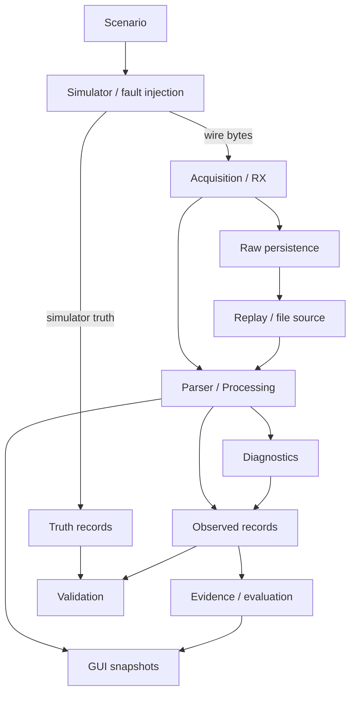

# Arquitetura do FO-IMU Virtual Testbench

## Objetivo

A arquitetura foi organizada para testar a interface digital da FO-IMU sem transformar o simulador em oráculo oculto do software avaliado.

A pergunta principal é:

> dado um fluxo de bytes e seus metadados de recepção, o host consegue processar, persistir, diagnosticar e explicar o que realmente observou?

## Fluxo principal

## Fronteira epistemológica

O projeto diferencia quatro conceitos:

- **truth**: fatos conhecidos pelo simulador/injetor;
- **observed**: fatos derivados apenas de bytes, tempos e eventos acessíveis ao host;
- **diagnostic**: inferências feitas a partir do observado;
- **validation**: comparação posterior entre evidência e critérios/oráculos permitidos.

O caminho `observed` não pode importar `truth` para melhorar resultados. Isso é testado por remoção/adulteração de truth e por um mutante deliberado de contaminação.

## Backend P2

A execução v2 separa três workers principais:

1. RX;
2. processamento;
3. writer.

As filas são limitadas. O encerramento usa orçamentos independentes por fase para evitar que um worker consuma todo o prazo disponível para os seguintes.

A persistência registra, entre outros:

- bytes brutos;
- índices/chunks;
- eventos;
- truth;
- métricas;
- avaliação;
- manifesto;
- relatório.

## Replay

Replay não é apenas “rodar de novo”. Há dois usos diferentes:

- **full audit replay**: pode exigir manifesto/truth para validar a execução completa;
- **observed reanalysis**: abre somente a projeção operacional permitida, `wire.bin` e timeline/chunks necessários.

Essa separação evita que informação do simulador apareça no resultado observado.

## Counter8

O counter de 8 bits não é tratado como contador absoluto de pacotes perdidos.

Política atual:

- `delta == 1`: contínuo, incluindo `255 -> 0`;
- `delta == 0`: repetição observada;
- `delta 2..127`: lacunas candidatas;
- `delta >=128`: salto ambíguo;
- múltiplos de 256: não observáveis pelo counter8 isolado.

Após salto ambíguo, o sistema entra em reacquisition e só fixa nova referência após progressão consecutiva compatível.

## Estados e evidência

Três eixos permanecem separados:

- `execution_status`;
- `evaluation_status`;
- `integrity_status`.

Uma execução cancelada não implica reprovação. Uma captura parcial não implica automaticamente ausência de evidência útil; a cobertura confirmada precisa ser explicitada.

Conclusões positivas exigem `EvidenceRef` concreto, cobertura e integridade suficientes para o claim.

## Observabilidade

Observabilidade é definida por **condição + detector + premissas + limite de detecção**.

Exemplo: perda múltipla de 256 frames é estruturalmente invisível ao detector counter8, mas isso não impede que outro detector independente possa observar efeitos relacionados se suas premissas forem satisfeitas.

Heurísticas temporais do host são, no máximo, warning quando não há base para causalidade física.

## GUI P3

A GUI é cliente do backend, não fonte de verdade.

Ela permite:

- configurar cenários;
- iniciar/parar Runs;
- acompanhar sinais e métricas;
- localizar eventos por tempo/intervalo de bytes;
- reabrir relatórios.

Fechar a GUI não deve corromper a aquisição nem enviar Stop implicitamente.

## Trusted Computing Base

O TCB observado inclui os componentes necessários para transformar bytes/timeline em evidência observada e persistente, incluindo parser, processamento, diagnóstico, storage, replay por arquivo, counter semantics, observability registry e evidence aggregation.

GUI e renderização ficam fora do TCB observado.

## Ancoragem externa

A arquitetura interna só ganha validade sobre a unidade física quando G5 confrontar as hipóteses com dados reais.

A primeira rodada de G5 deve evitar circularidade:

1. preservar raw original;
2. fazer scanner estrutural independente;
3. comparar com parser/checksum atuais;
4. registrar divergências;
5. classificar cada divergência;
6. só depois decidir se o software precisa mudar.
